# Projektdokumentation – Fokus Pomodoro-Timer

Stand: 11. November 2026 · Repository: https://github.com/Namir1234/Podomoro-Timer · Branch `main`

Diese Dokumentation fasst das ganze Projekt zusammen: was die App kann, wie sie
aufgebaut ist und wie sie sich vom ersten Commit bis heute entwickelt hat.
Die Chronik weiter unten ist aus der Git-Historie erstellt (115 Commits,
6. Oktober bis 11. November 2026) und wird bei jedem Commit und Push nachgeführt.

---

## 1. Überblick

**Fokus** ist ein Pomodoro-Timer mit Statistik, To-dos und Zitaten. Derselbe Web-Code läuft auf drei Arten.
Online unter **https://namir1234.github.io/Podomoro-Timer/** (GitHub Pages, Branch `main`):

| Plattform | Technik | Start |
| --- | --- | --- |
| Web / PWA | HTML, CSS, JavaScript, Service Worker | `pages/index.html` öffnen |
| Windows | Electron (eigenes `app://`-Protokoll) | `npm start`, Installer mit `npm run dist:win` |
| iOS | Capacitor + Xcode | `npm run ios:sync`, dann `npm run ios:open` (Mac nötig) |

Daten liegen lokal im `localStorage` (Keys `pomo_*`). Optional meldet man sich
an und gleicht sie über **Supabase** zwischen Geräten ab.

### Funktionen (aktueller Stand)

- Pomodoro-Timer mit Fokus-, Kurz- und Langpause, Vorlagen, Plus/Minus-Steppern,
  tippbaren Zeiten, optionalem Sekunden-Modus (dann auch Phasen unter einer
  Minute) und Ton-Schalter
- Popup „Zeit ist um!“ am Ende einer Pomodoro-Phase oder eines Timers; ist die
  App nicht im Vordergrund (minimiert, anderes Programm), zusätzlich als
  System-Mitteilung – abschaltbar unter „Mitteilung im Hintergrund“. Die
  Windows-App holt ihr Fenster dann selbst nach vorne, im Browser blinkt der
  Tab-Titel, auf dem Handy vibriert es. Schliesst man die Windows-App, während
  ein Timer läuft, bleibt sie im Infobereich der Taskleiste und meldet den Ablauf
- Überzeit: Nach Ablauf zählt der Pomodoro-Timer mit „+“ weiter (max. 60 min),
  bis man die nächste Phase startet – „Mehr gearbeitet“ bzw. „Pause überzogen“
- Oberfläche färbt sich gegen Ende der Phase rot
- Übersicht „Heute“: Fortschritt mit Tagesziel, Statistik, Zitat-Karte
- Statistik „Pausen & Überzeit“: Pausenminuten (heute/Woche), überzogene Pause
  und mehr gearbeitete Zeit (Woche) sowie Gesamtwerte
- Nur-Timer-Ansicht (Timer gross, alles andere ausgeblendet) – für den
  Pomodoro und für jeden eigenen Timer und jede Stoppuhr (Knopf ⤢ oben rechts
  in der Uhr, oder „Nur Timer“ auf dem Reiter Timer/Stoppuhr)
- Analoge Anzeige („Analog“ oben, Taste A): Zifferblatt statt Ziffern für
  Pomodoro, Timer und Stoppuhr; bei Countdowns zeigt ein Keil die
  Restminuten, bei der Stoppuhr Minuten- und Sekundenzeiger; die Zeit steht
  klein darunter. Pro Gerät gespeichert
- Umschalter oben auf der Timer-Seite: **Pomodoro**, **Timer**, **Stoppuhr** –
  beliebig viele eigene Timer und Stoppuhren (mit Runden), laufen auch nach
  dem Neuladen weiter
- Felder auf allen Seiten (Timer, To-do, Statistik, Zitate)
  frei verschieben und in der Grösse ändern, Inhalt skaliert mit; Timer- und
  Statistik-Seite passen immer auf einen Bildschirm, die untersten Felder
  reichen bis zum unteren Rand; beim Anordnen zeigt eine gestrichelte Linie,
  wo der Bildschirm endet (untere Feldkanten rasten dort ein); die Leiste
  „Layout bearbeiten“ lässt sich verschieben
- To-dos (mit optionaler Deadline); ▶ startet den Timer mit dem To-do als
  Fach, daneben steht die schon investierte Fokuszeit
- Statistik-Verlauf wählbar: 7 Tage (Minuten), 12 Wochen oder 12 Monate
  (Stunden); Export aller Sessions und Pausen als CSV (Excel-tauglich)
- Tastenkürzel auf der Pomodoro-Seite: Leertaste Start/Pause, R Reset,
  N Skip, F Nur Timer, A Analog (F und A auch bei Timer/Stoppuhr; in der
  maximierten Uhr Leertaste Start/Pause und R Reset)
- Startseite mit Screenshots (erzeugt mit `npm run screenshots`) und Link
  zum Quellcode
- Zitate: grosser Pool, zufällige Auswahl, eigene Zitate mit Autor
- Seitenmenü klappt beim Darüberfahren auf, Menüpunkte ein-/ausblenden und sortieren
- Mobile Ansicht mit Hamburger-Menü
- Sprache: Deutsch, Englisch, Französisch, Italienisch, Ungarisch
- Design wählbar: **Original** (Olivgrün) oder **Coral** – das App-Icon wechselt
  mit (Browser-Tab, Windows-Fenster/Taskleiste, iOS-Homescreen). Beide Designs
  haben dieselben Abstände und Schriftgrössen: Beim Wechseln bleiben alle Felder
  gleich gross und an derselben Stelle
- Login und Cloud-Sync über Supabase – inklusive Feldgrössen und Design
  (nur die Menü-Einstellung bleibt pro Gerät); Bestätigungsmail lässt sich
  erneut senden; E-Mail-Adresse und Passwort lassen sich im Konto ändern
- Live-Sync zwischen Geräten (Supabase Realtime): Eine auf dem Laptop
  gestartete Session läuft auf dem Handy sofort mit und lässt sich dort
  pausieren, überspringen oder zurücksetzen; To-dos, Uhren und Statistik
  aktualisieren sich ohne Neuladen. Der Pomodoro-Timer übersteht auch ein
  Neuladen (`pomo_timer`)
- Timer auf dem Sperrbildschirm (Handy): Phase, Endzeit und Fortschrittsbalken
  als „Wiedergabe“-Karte (Media Session), mit Pause/Weiter, Überspringen und
  Zurücksetzen; hält die Web-App im Hintergrund wach, damit Ton und Mitteilung
  pünktlich kommen. Pro Gerät abschaltbar („Auf dem Sperrbildschirm“), auf
  Handys standardmässig an
- iOS-App: statt der Wiedergabe-Karte eine **Live Activity** – eigene Zeile auf
  dem Sperrbildschirm und in der Dynamic Island mit Countdown und Balken,
  Musik anderer Apps (Spotify usw.) läuft weiter; am Ende eine Mitteilung mit
  Ton. Die `.ipa` baut GitHub Actions bei jedem Push (ohne eigenen Mac)

### Projektstruktur

| Ordner / Datei | Inhalt |
| --- | --- |
| `pages/` | `index.html` (Startseite), `pomodoro.html` (App) |
| `js/` | `pomodoro.js` (App-Logik), `i18n.js` (Übersetzungen), `cloud.js` + `cloud-config.js` (Supabase), `design-boot.js` (Design-Wahl), `vendor/supabase.js` |
| `style/` | `tokens.css`, `base.css`, `pomodoro.css`, `pomodoro-original.css`, `start.css`, `start-coral.css`, `lang-menu.css`, Schriften |
| `img/` | Icons, Bilder, App-Icons, `screens/` (Screenshots für Startseite und README), `doku/` (Vorher/Nachher-Bilder für diese Dokumentation) |
| `sw.js`, `manifest.json` | PWA (offlinefähig, installierbar) |
| `electron/` | Windows-Hülle (`main.js`, `preload.js`, `serve-dist.js`) |
| `ios/` | Xcode-Projekt (von Capacitor erzeugt), Targets `App` und `FokusWidget` (Live Activity), `Shared/` für beide |
| `.github/workflows/ios.yml` | Cloud-Build der iPhone-App (`Fokus.ipa`) auf einem Mac von GitHub |
| `supabase/schema.sql`, `supabase/ERD.md` | Tabelle `user_data` mit Row-Level-Security, Datenmodell-Diagramm |
| `tools/` | Build-Script, Icon-Renderer, Smoke-Test, `screenshots.js`, `compare-designs.js` (misst die Felder in beiden Designs) |
| `dist/` | Build-Ausgabe, nicht von Hand bearbeiten |
| `release/` | fertige Windows-Dateien |

Details zum Einrichten (Supabase, Windows, iOS) stehen im [README](README.md).

---

## 2. Arbeitsweise mit Git

- **Hauptbranch:** `main`, gepusht nach `origin` (GitHub).
- **Commit-Nachrichten:** auf Deutsch, kurz und beschreibend („Was wurde
  geändert“), meist ohne Umlaute (`ae`, `oe`, `ue`).
- **Autoren:** Alle Commits stammen von Namir Al Gorani, mit drei
  verschiedenen Git-Namen je nach Gerät/Konfiguration:
  `Namir1234` (6.–8. Okt.), `Namir Al Gorani` (ab 8. Okt.), `Namir` (3. Nov.).
- **Feature-Branches:** Grössere Änderungen wurden auf eigenen Branches
  gemacht und danach in `main` übernommen:

| Branch | Zweck | Stand |
| --- | --- | --- |
| `app-windows-ios` | Electron- und Capacitor-App | in `main` enthalten |
| `feature/login` | Login und Cloud-Sync | in `main` enthalten |
| `hallmark-test` | erster Design-Test (Theme Hedgerow) | in `main` enthalten |
| `hallmark-coral` | Coral-Design, wählbares Design | per Merge-Commit `1a3a846` in `main` |
| `agy-test`, `agy--test`, `worktree-agent-…` | Test-/Hilfsbranches | keine eigenen Commits ausserhalb von `main` |

Alle Nebenbranches haben keine Commits, die nicht schon in `main` sind – sie
könnten gelöscht werden.

---

## 3. Chronik

Format pro Commit: **Uhrzeit · Hash · Nachricht** – danach kurz, was das bedeutet
und wie gross die Änderung war (Dateien / +hinzugefügt / −entfernt).

### Phase 1 – Start und Sperr-Experimente (6. Oktober 2026)

Erster Stand der Web-App mit Startseite und Download. Danach viele schnelle
Versuche mit einer „Gerätesperre“ während der Pause, die später wieder
entfernt wurde.

| Zeit | Hash | Commit | Umfang |
| --- | --- | --- | --- |
| 14:49 | `ae891ae` | Fokus Pomodoro-Timer: Web-App, Startseite und Download | 24 Dateien, +867 |
| 15:31 | `1868295` | Sekunden pro Phase, Gerätesperre mit Autostart und Bild vor der Sperre | 5, +67 / −2 |
| 15:33 | `b2ffff3` | Overlay-Text nur Sperre versprechen, wenn wirklich verbunden | 2, +4 / −1 |
| 15:38 | `b10064b` | Bild nur noch 5 Sek. ohne Text, Status-Anzeige entfernt | 4, +4 / −20 |
| 15:48 | `ee96aad` | Sperre über gehostete Seite: CORS/PNA-Freigabe und zweiter Sende-Weg | 4, +19 / −5 |
| 15:54 | `69a2b07` | Startseiten-Zitate übersetzt, .bat startet lautlos, Sperr- und Bildoption entfernt | 6, +11 / −48 |
| 15:56 | `6cc031b` | Download-Pakete neu gebaut (lautlose Start-Datei) | 2 (binär) |
| 16:06 | `444271c` | Bild nur noch 3 Sekunden sichtbar | 1, +2 / −2 |
| 16:20 | `3b33980` | Vollbild-Sperre in der Seite: Bild 3 Sek., dann Pausen-Countdown | 3, +29 / −10 |
| 16:31 | `e1fad0b` | Neue Seite: Zitate berühmter Revolutionäre | 6, +58 |
| 16:33 | `8128870` | Sperrbild auf neues Bild geändert | 3, +1 / −1 |

### Phase 2 – Neue Seiten, Farbschema und Timer-Bedienung (7. Oktober 2026)

Sperre komplett raus, dafür To-dos, Notizen und Projekte. Danach mehrere
Runden am Farbschema und an der Zeiteinstellung.

| Zeit | Hash | Commit | Umfang |
| --- | --- | --- | --- |
| 12:09 | `a3994a4` | Sperr-Funktion komplett entfernt, neue To-do-Seite als 2. Menüpunkt | 11, +68 / −143 |
| 12:14 | `10ee2c1` | Neue Notizen-Seite: Ordner + Word-ähnlicher Editor mit Bildern | 4, +139 |
| 13:04 | `aa0d799` | Notizen: aktive Formatierung wird an den Knöpfen hervorgehoben | 2, +21 / −1 |
| 13:07 | `361731c` | Neue Projekte-Seite: pro Projekt eigene To-dos und Notizen | 4, +159 |
| 13:13 | `a024924` | Drei Zitat-Menüs zu einem zusammengefasst (Auswahl per Tabs) | 5, +59 / −40 |
| 13:40 | `10916ce` | Seitenmenü klappt beim Darüberfahren auf und wieder ein | 2, +29 / −18 |
| 13:47 | `705da92` | Neues Farbschema: Healing-Herbs-Grün (hell/Salbei) | 2, +44 / −37 |
| 13:49 | `17fb15d` | Farbschema auf dunkles Regenwaldgrün umgestellt | 2, +21 / −22 |
| 13:51 | `654b19b` | Stärkerer Kontrast: dunklerer Hintergrund, hellere Karten | 2, +14 / −13 |
| 13:55 | `83939b1` | Timer-Ring wird gegen Ende röter | 1, +9 / −1 |
| 13:59 | `b53ee41` | Ganze Akzentfarbe färbt sich gegen Ende rot | 1, +9 / −5 |
| 14:02 | `e67aa66` | Gesamte Oberfläche färbt sich gegen Ende rot | 1, +21 / −9 |
| 14:21 | `41f9ac4` | Zeiteinstellung vereinfacht: Vorlagen, Plus/Minus-Stepper, Ton-Schalter | 3, +82 / −37 |
| 14:28 | `18365db` | Zeiten tippbar und optionaler Sekunden-Modus | 3, +54 / −19 |
| 14:36 | `9616bfa` | Design verfeinert: Inter-Schrift, Modus-Umschalter, Fokus-Zustände | 4, +47 / −21 |
| 14:39 | `57d6164` | Weniger futuristisch: wärmeres Olivgrün, weichere Typografie | 3, +32 / −32 |
| 14:43 | `bdf2b14` | Timer-Seite als Übersicht: Heute-Fortschritt mit Tagesziel und Zitat-Karte | 3, +77 / −1 |

### Phase 3 – Zitate, Menü und Felder-Layout (8.–9. Oktober 2026)

Zitate erweitert, Menü anpassbar, Startseite aufgeräumt. Grösster Brocken:
Felder auf der Timer-Seite frei verschieben und skalieren.

| Datum | Zeit | Hash | Commit | Umfang |
| --- | --- | --- | --- | --- |
| 08.10. | 10:57 | `1d91c13` | Eigene Zitate mit Autor hinzufügen und löschen | 3, +55 / −12 |
| 08.10. | 11:29 | `57b611b` | Zitate: Pool erweitert, zufällige Auswahl mit Neue-Auswahl-Knopf | 3, +71 / −6 |
| 08.10. | 11:32 | `de8b66c` | Menü anpassbar: Menüpunkte ein-/ausblenden und Reihenfolge ändern | 3, +97 / −1 |
| 08.10. | 11:34 | `2f82980` | Menü-anpassen-Knopf mit eigenem Stift-Icon | 3, +4 / −2 |
| 08.10. | 14:47 | `246c56c` | Startseite aufgeräumt: kurze Erklärung, Zitat dezent am Rand | 2, +115 / −80 |
| 08.10. | 14:51 | `45e3510` | Startseite: Cache-Fix für CSS und feste Bildgrössen | 1, +6 / −6 |
| 08.10. | 14:54 | `27aa10b` | Nächstes-Zitat als kleiner Button statt Link | 2, +7 / −4 |
| 08.10. | 14:59 | `0a109cb` | Felder verschieben und in der Grösse ändern, To-dos mit optionaler Deadline | 4, +187 / −23 |
| 08.10. | 16:56 | `e52d0e7` | Timer-Seite: Layout-Bearbeitung für Felder (Position, Breite, Höhe) | 4, +672 / −106 |
| 08.10. | 19:38 | `ac6150c` | Felder-Layout: anstossende Felder automatisch verkleinern | 2, +302 / −33 |
| 08.10. | 23:32 | `eebe101` | Felder anpassen gefixt | 3, +850 / −8 |
| 09.10. | 08:33 | `0121df4` | Felder einfacher anpassen | 3, +190 / −84 |
| 09.10. | 08:50 | `dd1e7c6` | Timer-Menü nur ein Fenster gross | 3, +96 / −27 |

### Phase 4 – PWA und Mobile (9. und 21. Oktober 2026)

Die Webseite wird installierbar und offlinefähig, die Handy-Ansicht wird
brauchbar.

| Datum | Zeit | Hash | Commit | Umfang |
| --- | --- | --- | --- | --- |
| 09.10. | 12:47 | `c83cbe7` | PWA-Grundlagen: Manifest, Service Worker und App-Icons | 8, +139 |
| 09.10. | 13:04 | `97fee1f` | Mobile Ansicht: Hamburger-Menü statt Umbruch, normale Feldgrösse | 3, +97 / −10 |
| 21.10. | 08:50 | `a94d3a9` | Zitat von Fidel Castro entfernt | 1, −1 |
| 21.10. | 08:52 | `53679f5` | Service-Worker Cache-Version erhöht, damit Updates ankommen | 1, +1 / −1 |
| 21.10. | 09:03 | `aadd7e7` | Nur-Timer-Ansicht: Timer gross, alles andere ausgeblendet | 5, +172 / −8 |
| 21.10. | 09:13 | `acfb471` | Kopfzeile auf dem Handy: Knöpfe nur als Symbol | 3, +19 / −2 |

### Phase 5 – Native Apps (22. Oktober 2026)

| Datum | Zeit | Hash | Commit | Umfang |
| --- | --- | --- | --- | --- |
| 22.10. | 11:59 | `26003a3` | Pomodoro-Timer als App für Windows und iOS | 33, +5713 / −7 |

Electron-Hülle mit eigenem `app://`-Protokoll (fester Origin, damit der
`localStorage` Updates überlebt), Capacitor-Projekt für iOS, Build-Script nach
`dist/` mit Content-Security-Policy, Smoke-Test und Icon-Renderer. Die
grosse Zeilenzahl kommt vor allem von `package-lock.json` und dem Xcode-Projekt.
(Branch `app-windows-ios`)

### Phase 6 – Login und Cloud-Sync (1.–2. November 2026)

| Datum | Zeit | Hash | Commit | Umfang |
| --- | --- | --- | --- | --- |
| 01.11. | 14:44 | `3a23dca` | Login und Cloud-Sync über Supabase | 11, +441 / −6 |
| 02.11. | 11:15 | `ec48feb` | Statistik bei jedem Abgleich zusammenführen, Layout und Menü pro Gerät, Supabase-Projekt eingetragen | 3, +22 / −7 |

Jeder `pomo_*`-Key wird eine Zeile in der Tabelle `user_data`; Layout und Menü
bleiben pro Gerät. Offline gemerkte Änderungen (`pomo__dirty`) werden später
nachgeholt, die Statistik wird zusammengeführt statt überschrieben.
(Branch `feature/login`)

### Phase 7 – Mehrsprachigkeit (3.–4. November 2026)

| Datum | Zeit | Hash | Commit | Umfang |
| --- | --- | --- | --- | --- |
| 03.11. | 20:46 | `7b44a5d` | Sprache umschaltbar: Deutsch/Englisch für Oberfläche und Zitate | 8, +1007 / −371 |
| 04.11. | 08:25 | `3c0851d` | Sprachmenü mit Deutsch, Englisch, Französisch, Italienisch und Ungarisch | 8, +895 / −106 |

Neue Datei `js/i18n.js` mit allen Texten, eigenes Sprachmenü (`style/lang-menu.css`).

### Phase 8 – Wählbares Design: Original oder Coral (4. November 2026)

Auf den Branches `hallmark-test` / `hallmark-coral` wurde ein neues Design
ausprobiert und dann als zweite Option neben dem bisherigen eingebaut.

| Zeit | Hash | Commit | Branch | Umfang |
| --- | --- | --- | --- | --- |
| 09:47 | `45c595c` | Ausgangsstand vor Hallmark-Test | hallmark | 4, +179 / −16 |
| 10:01 | `eddd47d` | Hallmark-Test: Timer-Seite im Theme Hedgerow | hallmark | 15, +463 / −376 |
| 10:23 | `3d54ec8` | Hallmark-Test: Timer-Seite in Coral, dunkle Variante | hallmark | 20, +115 / −112 |
| 10:29 | `4bd1dd9` | Design wählbar: Original oder Coral, Seitenleiste wieder animiert | hallmark-coral | 8, +1098 / −22 |
| 10:34 | `6425028` | Felder skalieren mit ihrer Grösse, Timer-Seite passt auf einen Bildschirm | main | 4, +179 / −16 |
| 10:35 | `1a3a846` | **Merge** hallmark-coral: Design wählbar (Original oder Coral) | main | Merge |
| 10:35 | `2944965` | Build und Smoke-Test für wählbare Designs | main | 3, +9 / −4 |
| 10:44 | `2c63c6e` | Startseite auch in Coral, Design auf beiden Seiten gleich | main | 7, +112 / −33 |

Ablauf als Graph:

```
* 2c63c6e Startseite auch in Coral
* 2944965 Build und Smoke-Test
*   1a3a846 Merge hallmark-coral
|\
| * 4bd1dd9 Design waehlbar: Original oder Coral
| * 3d54ec8 Coral, dunkle Variante
| * eddd47d Theme Hedgerow
| * 45c595c Ausgangsstand vor Hallmark-Test
* | 6425028 Felder skalieren mit ihrer Groesse
|/
* 3c0851d Sprachmenue mit 5 Sprachen
```

Neu dazugekommen: `js/design-boot.js` (setzt das gewählte Design vor dem ersten
Rendern), `style/tokens.css`, `style/pomodoro-original.css`,
`style/start-coral.css`, Schriften General Sans und Geist Mono.

### Phase 9 – Freie Felder überall, Sync von Layout und Design (4. November 2026)

| Zeit | Hash | Commit | Branch | Umfang |
| --- | --- | --- | --- | --- |
| 10:53 | `5db0d94` | Projektdokumentation mit Chronik aller Commits | main | 1, +262 / −0 |
| 10:59 | `f2f4ebc` | Felder auf allen Seiten frei anpassbar wie auf der Timer-Seite | main | 6, +45 / −19 |
| 10:59 | `3283f8c` | Feldgrössen und Design mit dem Konto abgleichen | main | 4, +20 / −6 |
| 11:02 | `1c7c354` | Dokumentation nachgefuehrt, Regel fuer laufende Nachfuehrung | main | 2, +49 / −5 |

- **`5db0d94`** – Diese Datei (`DOKUMENTATION.md`) angelegt.
- **`f2f4ebc`** – To-do, Notizen, Projekte, Statistik und die drei Zitate-Tabs
  liegen jetzt im selben freien Layout (`.free-canvas`) wie die Timer-Seite:
  Felder verschieben, an allen Rändern und Ecken skalieren, Hilfslinien, Auto-Höhe.
  Der Inhalt wächst mit dem Feld (Standardbreite = halbe Breite, ein einzelnes
  Feld = ganze Breite). Eine früher gespeicherte Raster-Anordnung wird übernommen.
  Wächst ein Feld (z. B. neue Aufgaben), rutschen die Felder darunter nach.
  Neuer Übersetzungs-Key `q.current` („Zitat“) in allen fünf Sprachen,
  `CACHE_NAME` auf `fokus-cache-v25`.
- **`3283f8c`** – `pomo_layout` und `pomo_design` sind in `js/cloud.js` nicht mehr
  „nur pro Gerät“ und werden über Supabase auf alle angemeldeten Geräte
  übertragen; nur `pomo_menu` bleibt lokal. Ein Designwechsel auf der Startseite
  (dort läuft `cloud.js` nicht) wird in `pomo__dirty` vorgemerkt und beim
  nächsten Öffnen der Timer-Seite hochgeladen. Gepusht nach `origin/main`.
- **`1c7c354`** – Chronik bis hierher nachgeführt und in `CLAUDE.md` die Regel
  festgehalten, dass jeder Commit und Push hier eingetragen wird.

### Phase 10 – Eigene Timer und Stoppuhren (4. November 2026)

| Zeit | Hash | Commit | Branch | Umfang |
| --- | --- | --- | --- | --- |
| 11:26 | `1827153` | Eigene Timer und Stoppuhren auf neuer Seite Uhren | main | 7, +273 / −5 |
| 11:28 | `bcf96e2` | Dokumentation nachgefuehrt: Uhren | main | 1, +25 / −4 |
| 11:33 | `e3b38da` | Push vermerkt | main | 1, +6 / −3 |
| 11:40 | `fb04890` | Timer und Stoppuhr als Umschalter auf der Timer-Seite statt eigener Menuepunkt | main | 6, +129 / −40 |
| 11:40 | `cc221b4` | Dokumentation nachgefuehrt: Umschalter | main | 1, +21 / −7 |
| 11:42 | `07301db` | Push vermerkt | main | 1, +6 / −3 |
| 12:18 | `3ffd5a4` | Timer und Stoppuhr im gleichen Design wie der Pomodoro-Timer | main | 6, +85 / −54 |
| 12:18 | `80cd13a` | Dokumentation nachgefuehrt: Uhren-Design | main | 1, +15 / −4 |

- **`1827153`** – Neue Seite **Uhren** (Menüpunkt mit Stoppuhr-Icon
  `img/stopwatch.svg`, im Menü ein-/ausblendbar). Dort lassen sich beliebig viele
  normale Timer (Stunden:Minuten:Sekunden, Fortschrittsbalken, Ton und
  „Abgelaufen“ am Ende) und Stoppuhren (Zehntelsekunden, Runden) hinzufügen,
  umbenennen, starten, pausieren, zurücksetzen und löschen. Gespeichert in
  `pomo_clocks` (wird mit dem Konto abgeglichen). Laufende Uhren merken sich
  nur den Startzeitpunkt und laufen deshalb auch nach dem Neuladen weiter.
  Übersetzungen in allen fünf Sprachen, Styles für Original und Coral,
  `CACHE_NAME` auf `fokus-cache-v26`.
- **`bcf96e2`** – Chronik und Funktionsliste um die Uhren ergänzt.
  Zusammen mit `e3b38da` gepusht nach `origin/main`.
- **`fb04890`** – Auf Wunsch kein eigener Menüpunkt mehr: Die Seite „Uhren“
  ist entfernt. Stattdessen sitzt oben in der Kopfzeile der Timer-Seite ein
  kleiner Umschalter **[Pomodoro] [Timer] [Stoppuhr]** (ersetzt den Text
  „Pomodoro Arbeitsbereich“). Timer und Stoppuhren haben je eine eigene Fläche
  (`clockTimerCanvas`, `clockWatchCanvas`) im freien Layout, lange Listen
  scrollen. Der gewählte Tab wird pro Gerät gemerkt (`fokus_timer_tab`, nicht
  synchronisiert). „Nur Timer“ erscheint nur bei Pomodoro und springt immer
  dorthin. Auf schmalen Bildschirmen wird „Fokus“ neben dem Umschalter
  ausgeblendet. Übersetzungs-Keys `ttab.*`, `clocks.emptyTimer`/`emptyWatch`
  neu, `nav.clocks`, `clocks.title`, `clocks.empty` entfernt.
  `CACHE_NAME` auf `fokus-cache-v27`.
- **`cc221b4`** – Chronik und Funktionsliste zum Umschalter nachgeführt.
  Zusammen mit `07301db` gepusht nach `origin/main`.
- **`3ffd5a4`** – Jeder Timer und jede Stoppuhr ist jetzt eine eigene Karte im
  gleichen Design wie der Pomodoro-Timer: gleicher Ring (`.ring-wrap`), grosse
  Ziffern in der Mitte mit Text darunter, gleiche Knöpfe. Timer: Ring zeigt die
  Restzeit, darunter „von 05:00“ bzw. „Abgelaufen“ in Rot; im Ruhezustand
  werden die Ziffern direkt im Ring eingestellt („Zum Ändern antippen“).
  Stoppuhr: Ring läuft einmal pro Minute voll, darunter die laufende Runde.
  Der Name steht oben in einer Pille wie die Modus-Knöpfe. Das umschliessende
  Feld ist unsichtbar, die Uhren liegen direkt auf der Fläche. Neue Keys
  `clocks.setHint`, `clocks.of`; `CACHE_NAME` auf `fokus-cache-v28`.

### Phase 11 – Aufräumen und Rückmeldungen (5. November 2026)

| Zeit | Hash | Commit | Branch | Umfang |
| --- | --- | --- | --- | --- |
| 19:31 | `23d3140` | Datenmodell-Diagramm fuer Supabase | main | 1, +151 / −0 |
| 19:31 | `af80f9b` | Notizen und Projekte entfernt, Popup bei Ablauf, Bestaetigungsmail erneut senden | main | 12, +233 / −618 |
| 19:35 | `5e05bc0` | Dokumentation nachgefuehrt: Notizen und Projekte entfernt | main | 1, +52 / −15 |

- **`23d3140`** – `supabase/ERD.md`: Mermaid-Diagramm zu `schema.sql`. Zeigt die
  eine eigene Tabelle `public.user_data` und ihre Beziehung zu `auth.users`,
  die der Schema-Visualizer von Supabase nicht über die Schema-Grenze zeichnet.
- **`af80f9b`** – Mehrere Änderungen, die zusammen im Arbeitsverzeichnis lagen:
  - **Notizen und Projekte entfernt:** Menüpunkte, Seiten, Editor-Code
    (rund 210 Zeilen in `pomodoro.js`), Styles in beiden Designs, Icons
    `img/notes.svg`/`img/projects.svg` und alle zugehörigen
    Übersetzungs-Keys (`nav.notes`, `nav.projects`, `notes.*`, `folder.*`,
    `proj.*`, `ed.*`, `todo.emptyShort`). Beschreibungen in Manifest,
    `package.json`, Startseite und Konto-Text angepasst. Gespeicherte Daten
    (`pomo_notebooks`, `pomo_projects`) bleiben unangetastet, werden aber
    nicht mehr angezeigt; alte Menü-Einstellungen bleiben gültig.
  - **Popup „Zeit ist um!“** (`#timeUpModal`) nach jeder Pomodoro-Phase und
    wenn Timer ablaufen (mehrere gleichzeitig in einer Liste). Läuft die App
    im Hintergrund, kommt eine System-Mitteilung; die Erlaubnis wird beim
    ersten Start gefragt. Keys `done.*`.
  - **Sekunden-Modus:** heisst jetzt „Sekunden einstellen“, Phasen dürfen
    dann auch unter einer Minute liegen (mindestens 1 Sekunde).
  - **Uhren:** Timer mit Schnellwahl (10 s, 1, 5, 10 min) wie die Modus-Knöpfe,
    Ziffern direkt im Ring tippen (ab einer Stunde h:mm:ss), Namensfeld unten
    wie „Fach / Thema“.
  - **Konto:** Knopf „Bestätigungsmail erneut senden“, erscheint nur, wenn
    eine Bestätigung aussteht (`cloud.resendConfirmation`, Keys `acc.resend*`).
  - `CACHE_NAME` auf `fokus-cache-v31`.
- Doku-Commit: Chronik, Funktionsliste und Zahlen nachgeführt. Zusammen mit
  `3ffd5a4`, `80cd13a`, `23d3140` und `af80f9b` gepusht nach `origin/main`.

### Phase 12 – Überzeit und Pausen-Statistik (6. November 2026)

| Zeit | Hash | Commit | Branch | Umfang |
| --- | --- | --- | --- | --- |
| 08:35 | `cb938ba` | Ueberzeit nach Ablauf, Pausen-Statistik, zuverlaessigere Mitteilung | main | 9, +279 / −46 |
| 08:36 | `032b957` | Dokumentation nachgefuehrt: Ueberzeit und Pausen-Statistik | main | Doku |
| 11:05 | `10a7121` | App-Icon wechselt mit dem Design (Coral-Icon fuer Web, Windows und iOS) | main | 17, +162 / −20 |
| 11:05 | `64c0822` | Dokumentation nachgefuehrt: App-Icon pro Design | main | 1, +30 / −5 |
| 13:15 | `2ac9618` | Statistik passt auf einen Bildschirm, unterste Felder bis zum Rand | main | 4, +59 / −13 |
| 13:15 | `8cedd2c` | Cache-Version hochgezaehlt (Statistik-Layout) | main | 1, +1 / −1 |
| 13:20 | `50e6eff` | Dokumentation nachgefuehrt: Statistik-Layout | main | 1, +26 / −4 |
| 13:23 | `2a2250b` | Felder anordnen: Linie zeigt das Bildschirmende | main | 6, +104 / −13 |
| 13:25 | `1da7c8e` | Dokumentation nachgefuehrt: Linie am Bildschirmende | main | 1, +24 / −4 |
| 13:27 | `d47d125` | Leiste Layout bearbeiten verschiebbar | main | 6, +72 / −6 |
| 13:30 | `c55eafd` | Dokumentation nachgefuehrt: verschiebbare Leiste | main | 1, +18 / −4 |
| 13:30 | `f76fa77` | Statistik: Felder nie kleiner als ihr Inhalt, ganze Seite gleichmaessig verkleinert | main | 3, +11 / −15 |
| 13:31 | `10d8dc7` | Dokumentation nachgefuehrt: Statistik-Felder | main | 1, +23 / −3 |

- **`cb938ba`** – Wunsch: Mitteilung, wenn die App nicht offen ist, und sehen,
  wie viel man nach Ablauf länger gearbeitet bzw. Pause gemacht hat.
  - **Überzeit:** Nach Ablauf einer Phase wechselt der Pomodoro nicht mehr
    sofort, sondern zeigt `+mm:ss` (rot) mit „Mehr gearbeitet“ bzw. „Pause
    überzogen“. „Pause starten“/„Fokus starten“ beendet die Überzeit und startet
    gleich die nächste Phase, Reset/Skip wechseln nur. Gezählt werden höchstens
    60 min (`OVER_MAX_MIN`); beim Schliessen/Verstecken wird der Stand gespeichert.
  - **Daten:** Fokus-Sessions bekommen das Feld `over` (Minuten). Pausen werden
    neu in `pomo_breaks` gespeichert (`date`, `ts`, `min`, `kind`, `over`).
    Cloud-Sync führt beide Listen über `ts` zusammen; bei doppelten Einträgen
    gewinnt der mit mehr Überzeit. „Alle Daten löschen“ leert beide.
  - **Statistik:** neue Karte „Pausen & Überzeit“, in „Letzte Sessions“ steht
    die Überzeit als `+x`.
  - **Mitteilung:** kommt jetzt auch, wenn das Fenster offen, aber nicht im
    Vordergrund ist; genauer Timeout aufs Ende (auch für eigene Timer), damit
    sie im Hintergrund nicht bis zu einer Minute zu spät kommt; bleibt stehen,
    bis man sie wegklickt; Klick holt die App nach vorne (auch über den
    Service Worker). Neuer Schalter „Mitteilung im Hintergrund“ mit Hinweis,
    wenn blockiert. Electron: eigene App-ID für Windows-Mitteilungen und
    `backgroundThrottling: false`.
  - Neue Keys `done.over`, `over.*`, `btn.toBreak`, `btn.toFocus`,
    `toggle.notify`, `notify.*`, `stats.break*`, `stats.workOver`,
    `stats.overTotal`; `CACHE_NAME` auf `fokus-cache-v32`.
- Doku-Commit: Chronik, Funktionsliste und Zahlen nachgeführt. Zusammen mit
  `cb938ba` gepusht nach `origin/main`.
- **`10a7121`** – Wunsch: Das Icon der App soll sich ändern, wenn man das Design wechselt.
  - Neues Coral-Icon `img/icons/icon-coral-source.svg` (gleiche Form, Farben aus
    `tokens.css`: Hintergrund #181411, Ring Koralle #eb8975, Zeiger Creme).
    `npm run icons` rendert daraus `icon-coral-192/512.png`,
    `apple-touch-icon-coral.png` und das iOS-Icon `AppIconCoral`. Das Skript
    rendert jetzt offscreen mit Skalierung 1 (vorher falsche Grösse bei
    Windows-Zoom) und schafft mehrere Icons nacheinander.
  - `design-boot.js` setzt bei jedem Designwechsel und beim Laden das passende Icon:
    Browser (`<link rel="icon">` neu in beiden Seiten, `apple-touch-icon`),
    Windows über das neue `electron/preload.js` → `win.setIcon()` in `main.js`
    (Fenster und Taskleiste; `.exe`/Verknüpfung bleiben beim Original-Icon),
    iOS über das eigene Capacitor-Plugin `FokusIcon` in `AppDelegate.swift`
    (`setAlternateIconName`, eingebunden über `FokusViewController` in
    `Main.storyboard` und `ASSETCATALOG_COMPILER_ALTERNATE_APPICON_NAMES`).
  - Electron geprüft (Seite meldet Design, Favicon wechselt), `npm test` ok.
    iOS-Teil ist ohne Mac nicht gebaut.
  - `CACHE_NAME` auf `fokus-cache-v33`, Coral-Icons im Service-Worker-Cache.
- Doku-Commit: Chronik, Funktionsliste, Zahlen und offene Punkte nachgeführt.
  Zusammen mit `10a7121` gepusht nach `origin/main`.
- **`2ac9618`** – Rückmeldung: Die Statistik sah im Fenster anders aus als
  maximiert (im Fenster Seiten-Scrollen, maximiert leerer Platz unten), und in
  der Karte „Pausen & Überzeit“ (feste Höhe 255 px) war der Titel weggescrollt.
  - Die Statistik-Seite ist wie die Timer-Seite genau einen Bildschirm hoch
    (`body.page-stats`, CSS in beiden Designs); `freeFitToScreen` und
    `freeCapHeights` gelten für `FREE_FIT_BOXES` (Timer und Statistik).
  - Felder, unter denen nichts liegt, reichen immer bis zum unteren Rand –
    auf beiden Seiten (nur Anzeige, gespeichert bleibt die eigene Höhe).
  - Feste Feldhöhe auf diesen Seiten: Das Feld behält seine Grösse, der Inhalt
    wird so weit verkleinert, bis er ganz hineinpasst (kein innerer Scrollbalken).
    Nach `renderStats` wird der Massstab neu bestimmt.
  - Geprüft in Electron mit der eigenen Anordnung bei 1180×760 und 1600×1000:
    kein Seiten-Scrollen, beide Spalten enden am Rand; `npm test` ok.
- **`8cedd2c`** – `CACHE_NAME` auf `fokus-cache-v34` (im Commit davor fehlte
  der Schritt, weil `10a7121` schon v33 gesetzt hatte).
- Doku-Commit: Chronik, Funktionsliste und Zahlen nachgeführt. Zusammen mit
  `2ac9618` und `8cedd2c` gepusht nach `origin/main`.
- **`2a2250b`** – Wunsch: Beim Verschieben der Felder soll man sehen, wie gross
  ein Bildschirm ist, damit man nicht scrollen muss.
  - Im Bearbeitungsmodus zeigt jedes Raster eine gestrichelte Linie mit Text
    (`.free-screen`, Keys `layout.screenScroll` / `layout.screenFit`): auf To-do
    und Zitaten „darunter muss man scrollen“, auf Timer und Statistik „darunter
    wird alles verkleinert“. Untere Feldkanten rasten beim Ziehen und beim
    Ändern der Höhe an der Linie ein.
  - `freeScreenRoom()` rechnet den Platz bis zum Bildschirmrand so, wie er ohne
    Bearbeiten ist (die 0,8-Verkleinerung der Seite wird herausgerechnet).
    Einpassen und Strecken nutzen das ebenfalls – vorher wurden die untersten
    Statistik-Felder beim Bearbeiten über das spätere Bildschirmende hinaus
    verlängert.
  - Geprüft in Electron (Statistik, To-do, Timer): Linie liegt genau am
    späteren unteren Rand; Einpassen ohne Bearbeiten unverändert; `npm test` ok.
  - `CACHE_NAME` auf `fokus-cache-v35`.
- Doku-Commit: Chronik, Funktionsliste und Zahlen nachgeführt. Zusammen mit
  `2a2250b` gepusht nach `origin/main`.
- **`d47d125`** – Wunsch: Die Leiste „Layout bearbeiten“ (unten in der Mitte)
  verdeckt Felder und soll sich verschieben lassen.
  - Leiste irgendwo anfassen (nicht auf den Knöpfen) und ziehen; Griff-Symbol
    `⋮⋮` links. Der Platz wird pro Gerät gemerkt (`fokus_layoutbar_pos`, Anteil
    des freien Platzes, wird nicht synchronisiert) und passt sich der
    Fenstergrösse an. Doppelklick = zurück an den Standardplatz. Key `layout.barMove`.
  - Geprüft in Electron mit echten Maus-Events: Ziehen, Neuladen (Platz bleibt),
    „Fertig“ klickbar, Doppelklick setzt zurück; `npm test` ok.
  - `CACHE_NAME` auf `fokus-cache-v36`.
- Doku-Commit: Chronik, Funktionsliste und Zahlen nachgeführt. Zusammen mit
  `d47d125` gepusht nach `origin/main`.
- **`f76fa77`** – Rückmeldung: Die Statistik-Felder sahen „komisch“ aus –
  „Nach Fach“ und „Pausen & Überzeit“ mit winziger Schrift und Scrollbalken,
  „Übersicht“ halb leer.
  - Ursache: In der gespeicherten Anordnung überlappten sich „Nach Fach“
    (y 455, Höhe 277) und „Pausen“ (y 458); „Pausen“ wurde darum nach unten
    geschoben. Die Regel aus `2ac9618`, den Inhalt einzeln ins Feld
    einzupassen, hat diese Felder dann bis auf 50 % zusammengedrückt.
  - Neu: Auf der Statistik ist die eigene Feldhöhe eine Mindesthöhe – ein Feld
    wird nie kleiner als sein Inhalt, das unterste reicht bis zum Rand. Passt
    es insgesamt nicht, verkleinert `freeFitToScreen` das ganze Raster
    gleichmässig (wie auf der Timer-Seite). Die Einzel-Verkleinerung in
    `applyCardZoom` ist wieder entfernt; nach `renderStats` wird die Anordnung
    neu berechnet. Timer-Seite unverändert.
  - Geprüft mit der gespeicherten Anordnung bei 1180×760 und 1600×1000:
    einheitliche Schrift, keine Scrollbalken, kein Seiten-Scrollen; `npm test` ok.
  - `CACHE_NAME` auf `fokus-cache-v37`.
- Doku-Commit: Chronik und Zahlen nachgeführt. Zusammen mit `f76fa77`
  gepusht nach `origin/main`.

### Phase 13 – Live-Sync zwischen Geräten (8. November 2026)

| Zeit | Hash | Commit | Branch | Umfang |
| --- | --- | --- | --- | --- |
| 14:22 | `fdb8902` | Live-Sync zwischen Geraeten, Timer-Stand gespeichert | main | 5, +143 / −29 |
| 14:24 | `c22ad03` | Dokumentation nachgefuehrt: Live-Sync | main | Doku |

- **`fdb8902`** – Wunsch: Eine auf dem Laptop gestartete Session soll man auf
  dem Handy sehen und bearbeiten können.
  - **Timer-Stand:** Der Pomodoro (Modus, Restzeit, Endzeit, Runden, Überzeit)
    wird neu als `pomo_timer` gespeichert – nur absolute Zeitpunkte, jedes Gerät
    rechnet selbst. Er übersteht so auch ein Neuladen. Lief eine Phase ab,
    während die App zu war, zählt sie beim Öffnen; liegt das Ende über 60 min
    zurück, geht es ohne Überzeit gleich zur nächsten Phase. `finish()` zählt
    eine Session nur einmal (gleicher `ts` auf allen Geräten).
  - **Live-Empfang (`js/cloud.js`):** Supabase-Realtime-Kanal auf die eigenen
    Zeilen von `user_data`. Über `cloud.onRemote(key, fn)` zeigt `pomodoro.js`
    Timer, Sessions, Pausen, To-dos, Uhren und Fach sofort an; andere Keys laden
    die Seite wie bisher neu. Echos eigener Uploads werden erkannt (kein
    Zurückspringen bei Start + gleich Pause). Timer-Änderungen gehen nach 150 ms
    statt 1 s hoch. Fallback: Abgleich beim Zurückwechseln in die App und wenn
    sie wieder online ist.
  - Läuft eine Phase auf mehreren offenen Geräten ab, kommen überall Ton und
    Popup; geht ein Gerät weiter, schliesst sich das Popup auf den anderen.
  - `supabase/schema.sql`: `alter publication supabase_realtime add table user_data;`
    (muss einmal im SQL Editor laufen).
  - Geprüft in Electron: Neuladen bei laufendem und pausiertem Timer,
    abgelaufene Phase (eine Session), fremde Stände (Start, Pause, Ablauf,
    Weiterwechseln); `npm test` ok. Realtime mit zwei echten Geräten noch offen.
  - `CACHE_NAME` auf `fokus-cache-v38`.
- Doku-Commit: Chronik, Funktionsliste, Zahlen und offene Punkte nachgeführt.
  Zusammen mit `fdb8902` gepusht nach `origin/main`.

### Phase 14 – Timer auf dem Sperrbildschirm (8. November 2026)

| Zeit | Hash | Commit | Branch | Umfang |
| --- | --- | --- | --- | --- |
| 15:05 | `3678553` | Timer auf dem Sperrbildschirm (Media Session) | main | 5, +135 / −4 |
| 15:07 | `09a9b40` | Dokumentation nachgefuehrt: Sperrbildschirm | main | Doku |

- **`3678553`** – Wunsch: Auf dem Handy (iPhone, Web-App) soll der Timer wie
  eine Live-Aktivität auf dem Sperrbildschirm stehen, damit man die App nicht
  offen haben muss. Echte Live Activities gibt es nur für native iOS-Apps
  (Swift, Mac nötig); die Web-App nutzt darum die Media Session.
  - **`drawLock()`** (aus `draw()`, ändert nur bei neuem Zustand): Titel =
    Phase bzw. „Mehr gearbeitet“/„Pause überzogen“, Untertitel „Endet um 14:35“,
    „Pausiert – noch 12:00“ oder „Seit 14:35“, App-Icon des Designs als Bild.
    `setPositionState` gibt den Balken vor, den das Handy selbst weiterzählt
    (Überzeit zählt aufwärts bis 60 min).
  - Dafür spielt ein stummes 10-s-WAV in Schleife (als `data:`-URL, die
    App-CSP erlaubt kein `blob:`). Nachteil: andere Musik wird pausiert.
    Vorteil: Die Seite schläft im Hintergrund nicht ein.
  - Knöpfe: Play/Pause = Start/Pause, Vor = Skip, Zurück = Reset; in der
    Überzeit beendet Pause sie. Nach Skip/Reset bleibt die Karte stehen, damit
    man die nächste Phase vom Sperrbildschirm aus startet.
  - Schalter „Auf dem Sperrbildschirm“ unter den Zeiteinstellungen, gespeichert
    pro Gerät (`pomo_lockscreen`, in `cloud.js` bei `DEVICE_ONLY`); Standard an
    bei Touch-Geräten. Texte in allen 5 Sprachen.
  - Ton am Ende: ein gemeinsamer `AudioContext`, beim Tippen auf Start
    freigegeben (`unlockAudio()` in `askNotify()`) – iOS spielt sonst im
    Hintergrund keinen Ton ab.
  - Geprüft in Electron: Start, Pause, Skip, Überzeit, Speichern des Schalters;
    `npm test` ok. Auf einem echten iPhone noch nicht getestet.
  - `CACHE_NAME` auf `fokus-cache-v39`.
- Doku-Commit: Chronik, Funktionsliste, Zahlen und offene Punkte nachgeführt.
  Zusammen mit `3678553` gepusht nach `origin/main`.

### Phase 15 – Ausbau, Aufräumen und Schaufenster (8. November 2026)

| Zeit | Hash | Commit | Branch | Umfang |
| --- | --- | --- | --- | --- |
| 21:14 | `9192098` | Autorname vereinheitlicht (.mailmap) | claude/app-website-next-steps | 1, +3 / −0 |
| 21:14 | `6591a98` | Verlauf ueber Wochen/Monate, CSV-Export, Zeit pro To-do, Tastenkuerzel, Startseite mit Screenshots | claude/app-website-next-steps | 15, +447 / −45 |
| 21:20 | `e382d13` | Dokumentation nachgefuehrt: Ausbau und Schaufenster | claude/app-website-next-steps | Doku |
| 21:35 | `87efdb3` | Dokumentation nachgefuehrt: Realtime geprueft | claude/app-website-next-steps | Doku |

Auftrag: Nach der Frage „Was kann ich jetzt mit App und Webseite machen?“
alle vorgeschlagenen Schritte umsetzen (online stellen, offene Punkte,
aufräumen, vorzeigbar machen, ausbauen).

- **Online:** GitHub Pages war schon aktiv und auf dem neusten Stand
  (`fokus-cache-v39` live). Adresse jetzt in README und Doku.
- **`9192098`** – `.mailmap`: `Namir1234`, `Namir` und `Namir Al Gorani`
  erscheinen in `git log`/`shortlog` einheitlich als „Namir Al Gorani“.
  Die Historie bleibt unverändert (kein Umschreiben, kein Force-Push).
- **`6591a98`** – Ausbau und Schaufenster:
  - **Verlauf:** Umschalter 7 Tage / 12 Wochen / 12 Monate über dem Diagramm
    (`renderChart()`, `chartBuckets()`); Wochen beginnen am Montag, Wochen
    und Monate in Stunden. Wahl pro Gerät (`pomo_chart_range`, nicht synchronisiert).
  - **CSV-Export** („Als CSV exportieren“ unter den letzten Sessions):
    Semikolon + BOM, Zahlen im Format der Sprache, Formel-Zeichen am
    Zellanfang werden entschärft. Auf Handys über „Teilen“, sonst Download.
  - **Zeit pro To-do:** ▶ setzt das To-do (max. 30 Zeichen) als Fach und
    wechselt zum Timer; die Fokuszeit aller Sessions mit diesem Fach steht
    als Schild am To-do (ab 60 min in Stunden). Aktualisiert sich nach jeder
    Session und beim Live-Sync.
  - **Tastenkürzel:** Leertaste, R, N, F – nur auf der Pomodoro-Seite, nicht
    beim Tippen, nicht bei offenen Dialogen oder im Layout-Modus. Hinweis
    unter den Zeiteinstellungen (auf Touch-Geräten ausgeblendet).
  - **Handy-Kopfzeile:** Bis 480 px steht der Umschalter Pomodoro/Timer/
    Stoppuhr in einer eigenen Zeile – vorher überlappte „Stoppuhr“ den
    Vollbild-Knopf.
  - **Startseite:** fünf Funktionen statt drei, Hinweis zu Konto/Sync
    korrigiert („ohne Anmeldung“ stimmte nicht mehr), Bereich „So sieht
    Fokus aus“ mit Statistik- und Handy-Screenshot, Link zum Quellcode.
  - **`tools/screenshots.js`** (`npm run screenshots`): Electron offscreen
    mit eigenem Profil und Beispieldaten → `img/screens/*.png`.
  - **README:** Live-Link, Screenshots, Funktionsliste.
  - Texte in allen 5 Sprachen. Geprüft im Browser (Desktop und 375 px, beide
    Designs) und mit `npm test` (ok). `CACHE_NAME` auf `fokus-cache-v40`.
- Nicht gemacht: Fokus-Blocklisten (eine Webseite kann andere Seiten nicht
  sperren, das ginge nur als Browser-Erweiterung); Branches löschen (von der
  Sicherheitsprüfung blockiert, Befehle unter „Offene Punkte“).
- Supabase: Im SQL Editor geprüft – `user_data` war schon für Realtime
  freigegeben, der `alter publication`-Befehl war nicht mehr nötig.
- Doku-Commit: Chronik, Funktionsliste, Projektstruktur, Zahlen und offene
  Punkte nachgeführt. Zusammen mit `9192098` und `6591a98` gepusht nach
  `origin/main` (Fast-Forward vom Branch `claude/app-website-next-steps`).

### Phase 16 – Popup bei Ablauf und Infobereich (am 6. November auf einem Nebenbranch entwickelt, am 9. November gemergt)

| Zeit | Hash | Commit | Branch | Umfang |
| --- | --- | --- | --- | --- |
| 11:05 | `2a38279` | Popup bei Ablauf nicht mehr verpassen: Fenster nach vorne, Titel blinkt | worktree-popup-ablauf | 5, +66 / −7 |
| 11:10 | `e9693ac` | Dokumentation nachgefuehrt: Popup bei Ablauf | worktree-popup-ablauf | Doku |
| 11:14 | `cc74893` | Windows-App laeuft beim Schliessen im Infobereich weiter, solange ein Timer laeuft | worktree-popup-ablauf | 5, +64 / −8 |
| 11:16 | `c7a4170` | Dokumentation nachgefuehrt: Infobereich | worktree-popup-ablauf | Doku |
| 9.11. 10:06 | `ea4f518` | Merge worktree-popup-ablauf: Popup bei Ablauf und Infobereich | claude/app-website-next-steps | 6, +163 / −13 |
| 9.11. 10:10 | `a60db21` | Dokumentation nachgefuehrt: Merge Popup und Infobereich | claude/app-website-next-steps | Doku |
| 9.11. 10:20 | `01176dd` | Dokumentation nachgefuehrt: Branches aufgeraeumt | claude/app-website-next-steps | Doku |
| 9.11. 10:13 | `7104b6f` | Version 1.1.0 (Windows-App neu gebaut) | claude/app-website-next-steps | 2, +2 / −2 |
| 9.11. 10:15 | `3122b3b` | Dokumentation nachgefuehrt: Version 1.1.0 | claude/app-website-next-steps | Doku |

- **`2a38279`** – Wunsch: Ein Popup soll kommen, wenn die Zeit abgelaufen ist,
  damit man weiss, dass es fertig ist. Das Popup „Zeit ist um!“ gab es schon,
  war aber unsichtbar, wenn die App minimiert oder verdeckt war.
  - **Windows-App:** neues `electron/preload.js` stellt `window.fokusApp.timeUp()`
    bereit. `main.js` holt das Fenster bei Ablauf aus der Taskleiste, legt es
    „immer oben“ und lässt das Taskleisten-Symbol blinken, bis man es anklickt
    (Windows verweigert `focus()` aus dem Hintergrund oft).
  - **Browser:** Der Tab-Titel blinkt „⏰ Zeit ist um!“, bis man zurückkommt
    oder OK drückt; auf dem Handy vibriert es zusätzlich (`navigator.vibrate`).
  - Gilt für Pomodoro und eigene Timer (beide laufen über `showTimeUp`).
    `pomodoro.js?v=35`, `CACHE_NAME` auf `fokus-cache-v33`.
- Doku-Commit `e9693ac`: Chronik, Funktionsliste und Zahlen nachgeführt.
- **`cc74893`** – Rückmeldung: Es kommt keine Mitteilung, wenn die App
  geschlossen ist. Grund: Schliessen beendete die ganze App, danach lief kein
  Code mehr.
  - Läuft der Pomodoro oder ein eigener Timer, versteckt Schliessen das Fenster
    nur; die App bleibt mit Symbol im Infobereich der Taskleiste (Menü
    „Fokus öffnen“ / „Beenden“, Klick öffnet). Beim ersten Mal erklärt eine
    Mitteilung das. Bei Ablauf kommt das Fenster mit Popup zurück.
  - Läuft nichts, beendet Schliessen die App wie bisher; „Beenden“ im Menü
    beendet immer.
  - Die Seite meldet den Zustand alle 0,5 s über `fokusApp.setBusy()`
    (Kanal `fokus-busy`). `pomodoro.js?v=36`, `CACHE_NAME` auf `fokus-cache-v34`.
- Doku-Commit: Chronik und Zahlen nachgeführt. Branch `worktree-popup-ablauf`
  gepusht nach `origin`; noch nicht in `main`.
- **`ea4f518`** – Merge drei Tage später: Der Branch war vollständig, aber nie
  in `main` gelandet.
  - Konflikte: `electron/preload.js` stellt jetzt `setDesign`, `timeUp` und
    `setBusy` bereit; `electron/main.js` vereint Design-Icon und Infobereich.
    Das Symbol im Infobereich und die Hinweis-Mitteilung folgen dem gewählten
    Design (`aktuellesIcon`, `tray.setImage` beim Wechsel).
  - `js/pomodoro.js` liess sich automatisch zusammenführen (Titel blinkt,
    Vibration, `fokusApp.timeUp()`/`setBusy()`).
  - `pomodoro.js?v=41`, `CACHE_NAME` auf `fokus-cache-v41`.
  - Geprüft in der echten Fenster-Huelle mit leerem Profil: 4-s-Timer starten
    → `busy=true`, Fenster schliessen → versteckt statt beendet, nach Ablauf
    wieder sichtbar mit Popup, nach Reset `busy=false`; `npm test` ok.
- Doku-Commit: Abschnitt als Phase 16 eingeordnet, Chronik, Zahlen und offene
  Punkte nachgeführt. Zusammen mit dem Merge gepusht nach `origin/main`.
- **Aufräumen** (nach Prüfung, dass alles in `main` ist): Worktrees
  `.claude/worktrees/agent-a3fd…` und `.claude/worktrees/popup-ablauf`
  entfernt; lokale Branches `agy--test`, `agy-test`, `app-windows-ios`,
  `worktree-agent-a3fd603009cb31500`, `feature/login`,
  `worktree-popup-ablauf` gelöscht; auf GitHub `hallmark-coral` und
  `worktree-popup-ablauf`. Doku-Commit gepusht nach `origin/main`.
- **`7104b6f`** – Version 1.1.0: Die installierte Windows-App war noch 1.0.0
  vom 8. November (ohne Live-Sync, Sperrbildschirm und alles danach).
  `npm run dist:win` → `release/Fokus Setup 1.1.0.exe`, still installiert
  (`/S`, pro Benutzer nach `%LOCALAPPDATA%\Programs\Fokus`) und gestartet.
  Die Daten bleiben erhalten (gleicher `app://`-Origin). README nennt die
  neuen Dateinamen.
- Doku-Commit: Chronik und Zahlen nachgeführt. Gepusht nach `origin/main`.

### Phase 17 – Live Activity für die iOS-App (9. November 2026)

| Zeit | Hash | Commit | Branch | Umfang |
| --- | --- | --- | --- | --- |
| 10:48 | `5e17dc4` | Live Activity fuer die iOS-App, Mitteilung am Ende, Cloud-Build der .ipa | claude/app-website-next-steps | 13, +682 / −13 |
| 11:00 | `64c1382` | Dokumentation nachgefuehrt: Live Activity | claude/app-website-next-steps | Doku |
| 11:26 | `9211a3f` | Live Activity wie der Timer der Uhr-App: Ring, grosse Zeit, Pause- und Stopp-Knopf | claude/app-website-next-steps | 8, +309 / −124 |
| 11:35 | `ae2acfe` | Dokumentation nachgefuehrt: Live Activity mit Knoepfen | claude/app-website-next-steps | Doku |

- **`5e17dc4`** – Wunsch: Hört man Spotify, verdrängt die Musik die
  „Wiedergabe“-Karte des Timers vom Sperrbildschirm (davon gibt es auf dem
  iPhone nur eine). Der Timer soll wie der der Uhr-App eine eigene Zeile haben.
  Das geht nur nativ (ActivityKit), nicht in einer Webseite.
  - **Widget-Erweiterung** `ios/App/FokusWidget/` (neues Target, iOS 16.2+):
    Sperrbildschirm mit Symbol, Phase, „Endet um …“, grossem Countdown und
    Balken; Dynamic Island kompakt (Symbol + Zeit), erweitert (dazu Balken),
    minimal (Symbol). Countdown und Balken über `Text`/`ProgressView` mit
    `timerInterval` – iOS zählt selbst, die App darf schlafen. Ab dem Ende gilt
    die Anzeige als veraltet (`staleDate`) und zeigt „Zeit ist um!“. Pause:
    feste Restzeit; Überzeit: zählt aufwärts. Farben je Design.
  - **`FokusTimerAttributes.swift`** in `ios/App/Shared/`, in beiden Targets.
  - **`FokusTimerPlugin.swift`** (in `FokusViewController` angemeldet):
    `update` (startet oder ändert die Live Activity), `end`, `schedule`
    (lokale Mitteilung mit Ton genau am Ende, löscht die vorige),
    `requestPermission`. Aufrufe laufen streng nacheinander.
  - **`js/pomodoro.js`**: erkennt die iOS-App (`window.Capacitor`), nimmt dort
    `drawLive()` statt Media Session (keine stumme Wiedergabe mehr, Musik
    läuft weiter) und plant die Mitteilung mit `syncNativeNotify()`; der
    Schalter „Mitteilung im Hintergrund“ ist in der App jetzt nutzbar. Beim
    Start werden alte Live Activities beendet. Hinweistext „lock.hintApp“ in
    5 Sprachen. `CACHE_NAME` auf `fokus-cache-v42`.
  - **Xcode-Projekt** von Hand ergänzt (Target, Einbetten der Erweiterung,
    Abhängigkeit); App linkt ActivityKit schwach (läuft auch unter iOS 16);
    Version 1.1; `NSSupportsLiveActivities` in `Info.plist`.
  - **`.github/workflows/ios.yml`**: baut auf `macos-15` (npm ci, `ios:sync`
    mit pod install, `xcodebuild` ohne Signatur) und lädt `Fokus.ipa` als
    Artifact „Fokus-iOS“ hoch (30 Tage). Aufspielen mit Sideloadly (README).
  - Geprüft: JS-Seite in Electron mit vorgetäuschter iOS-Brücke (Start, Pause,
    Weiter, Skip schicken die richtigen `update`/`end`/`schedule`-Aufrufe);
    Cloud-Build Lauf 42596211962 grün in 2:40 min, `FokusWidget.appex` in der
    App; `npm test` ok. Auf einem echten iPhone noch nicht gesehen.
- Doku-Commit: Funktionsliste, Projektstruktur, Chronik, Zahlen, offene Punkte
  und README (Abschnitt iOS: Live Activity, Cloud-Build, Sideloadly)
  nachgeführt. Gepusht nach `origin/main`.
- **`9211a3f`** – Rückmeldung mit Screenshots vom Timer der Uhr-App: So soll
  es aussehen.
  - **Sperrbildschirm** jetzt einzeilig wie die Uhr-App: links runder
    Pause/Weiter-Knopf (Akzentfarbe) und ✕-Knopf, rechts Beschriftung
    („Fokus“, „Kurze Pause“ …) und grosse, dünne Zeit; dunkler Hintergrund.
    Überzeit zählt mit „+“ aufwärts, nach Ablauf steht „Zeit ist um!“ da.
  - **Dynamic Island**: kompakt links ein Ring, der sich leert, rechts die Zeit;
    erweitert Knöpfe links, Beschriftung und Zeit rechts; minimal der Ring.
  - **Knöpfe** (ab iOS 17, `Shared/FokusTimerIntents.swift`):
    `FokusPauseIntent` und `FokusStopIntent` (`LiveActivityIntent`, laufen im
    App-Prozess). Sie ändern Live Activity und Mitteilung selbst
    (`FokusTimerStore`) und merken sich die Aktion; `js/pomodoro.js` holt sie mit
    `takePending` ab (beim Zurückkommen und alle 2 s) und übernimmt Pause,
    Weiter oder Stopp (= Reset bzw. Überzeit beenden) – damit auch auf die
    anderen Geräte. Unter iOS 16 erscheint statt der Knöpfe ein Symbol.
  - `ContentState`: `remainingSec` und `total` statt Text/Fortschritt;
    Restzeit im Format der Uhr-App („4:58“). App linkt auch `AppIntents` schwach.
    `CACHE_NAME` auf `fokus-cache-v43`.
  - Geprüft: Knopf-Aktionen in Electron mit vorgetäuschter iOS-Brücke (Pause →
    Restzeit 600 s, Weiter → läuft mit neuer Endzeit, Stopp → zurückgesetzt und
    gespeichert); Cloud-Build Lauf 42600906847 grün; `npm test` ok.
- Doku-Commit: Chronik, Zahlen und offene Punkte nachgeführt. Gepusht nach
  `origin/main`.

### Phase 18 – Felder in beiden Designs gleich gross (11. November 2026)

| Zeit | Hash | Commit | Branch | Umfang |
| --- | --- | --- | --- | --- |
| 11:19 | `a7d00ea` | Felder in beiden Designs gleich gross: Original uebernimmt Abstaende und Schriftgroessen von Coral | claude/field-size-consistency-320fcf | 8, +308 / −188 |
| 11:25 | `11906d4` | Dokumentation nachgefuehrt: Felder gleich gross | claude/field-size-consistency-320fcf | Doku |

- **`a7d00ea`** – Rückmeldung mit zwei Screenshots: Wechselt man das Design,
  sind die Felder verschieden gross (z.B. „Heute“ und „Zeiten einstellen“
  höher oder tiefer, „Deep Work“ zweizeilig). Grund: `pomodoro-original.css`
  und `pomodoro.css` (Coral) hatten je eigene Abstände, Schriftgrössen,
  Zeilenhöhen und Ränder.
  - **Gleiche Masse**: Das Original lädt jetzt auch `tokens.css` und
    `base.css` und übernimmt von Coral Regel für Regel alle Grössen
    (Innen-/Aussenabstände, Lücken, Breiten, Höhen, Schriftgrössen,
    Zeilenhöhen). Farben, Rundungen, Schatten und Schrift (Inter) bleiben.
  - **Ränder ohne Platzbedarf**: Rahmen von Feldern, Moduswahl, Umschalter
    oben und Stoppuhr-Feldern sind im Original jetzt `inset`-Schatten statt
    `border` (Coral hat dort keinen Rand) – gleich sichtbar, 0 px Platz.
  - **Kacheln** bei „Heute“ und in der Statistik: Coral trennt mit Linien,
    das Original zeigt Kacheln. Die Kachel ist jetzt ein `::before` hinter dem
    Inhalt; Abstände und (unsichtbare) Linien wie bei Coral.
  - **Schriftbreite**: Inter läuft breiter als General Sans. Mit leicht
    engerem Zeichenabstand (`-.025em` im Text, `-.03em` auf fetten Knöpfen,
    `-.035em` bei Zitaten) brechen Zeilen gleich um.
  - Für schmale Bildschirme die Coral-Regel für Moduswahl und Vorlagen auch
    im Original. `CACHE_NAME` auf `fokus-cache-v44`, `pomodoro-original.css?v=12`.
  - **Neues Werkzeug** `tools/compare-designs.js`: lädt Timer, To-do,
    Statistik und Zitate in beiden Designs (mit festem Zufall, damit dieselben
    Zitate kommen) und meldet jedes Feld, das in Breite, Höhe oder Lage
    abweicht. Optionen `--breite 390` (Handy), `--tief` (alle Elemente),
    `--shots <ordner>` (Screenshots).
  - Geprüft: Bei 1280 px Breite sind alle Felder auf allen vier Seiten in
    beiden Designs gleich gross und gleich platziert (vorher 52 Abweichungen);
    nur Knöpfe innerhalb der Felder sind 2–4 px schmaler/breiter. `npm test` ok.

  | | Original | Coral |
  | --- | --- | --- |
  | **Vorher** | 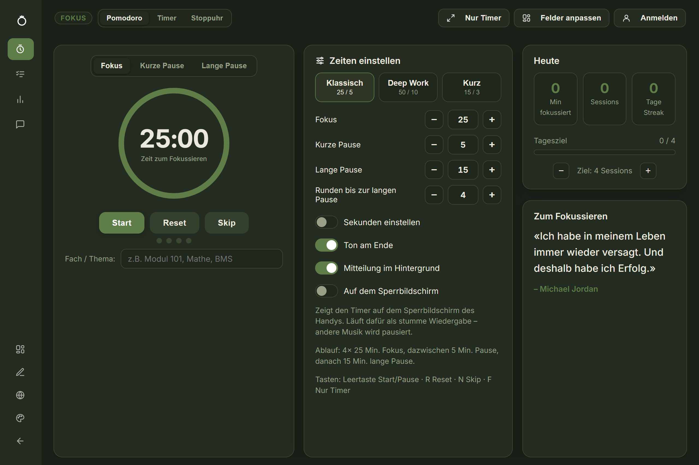 | 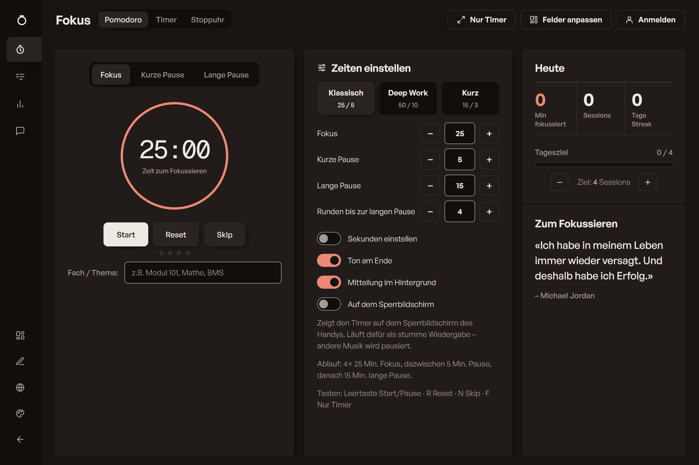 |
  | **Nachher** | 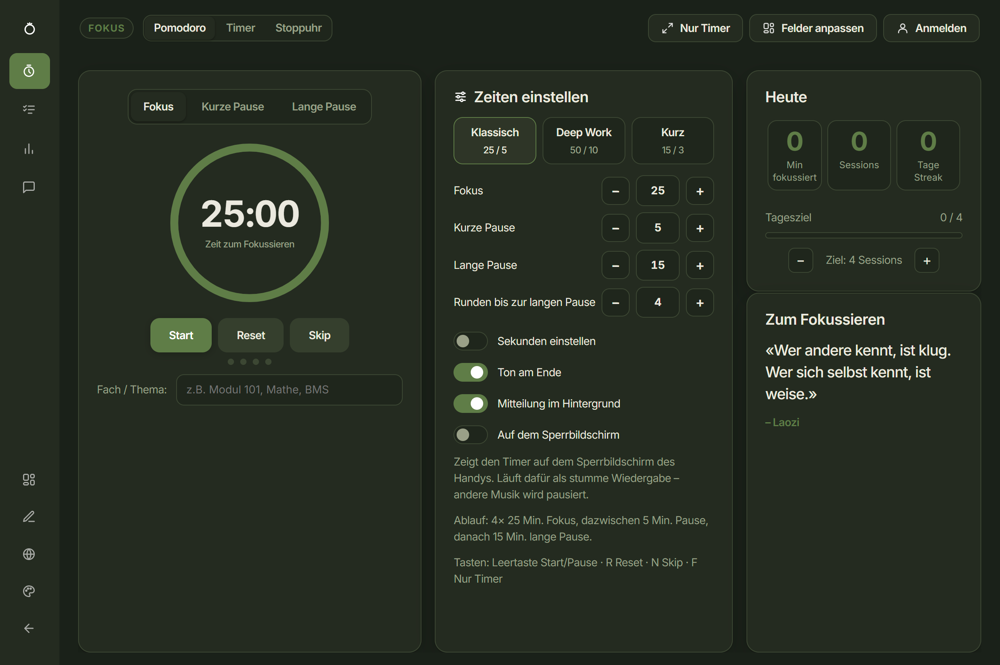 | 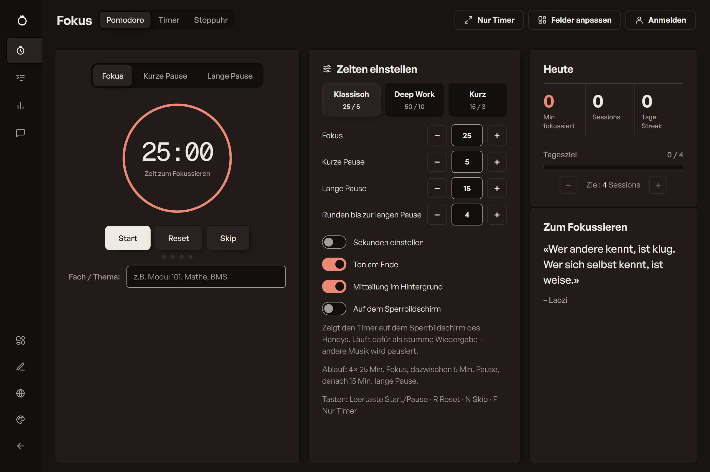 |

- Doku-Commit: Funktionsliste, Projektstruktur, Chronik mit Vorher/Nachher-
  Screenshots, Zahlen und offene Punkte nachgeführt. Nach dem Test durch
  Namir in `main` übernommen (Fast-Forward) und gepusht nach `origin/main`.

### Phase 19 – Timer und Stoppuhr maximieren, analoge Anzeige (11. November 2026)

| Zeit | Hash | Commit | Branch | Umfang |
| --- | --- | --- | --- | --- |
| 11:38 | `d4d0204` | Timer und Stoppuhr maximierbar, analoge Anzeige als Zifferblatt | feature/uhren-maximieren-analog | 15, +234 / −30 |
| 11:45 | `05e71e3` | Dokumentation nachgefuehrt: Uhren maximieren und analog | feature/uhren-maximieren-analog | Doku |

- **`d4d0204`** – Wunsch: Timer und Stoppuhr sollen sich wie der Pomodoro
  maximieren lassen, und die Zeit soll man auch analog anzeigen können.
  - **Maximieren**: Jede Uhr hat oben rechts einen Knopf ⤢. „Nur Timer“ und
    Taste F gehen jetzt auf allen drei Reitern (vorher nur beim Pomodoro):
    bei Timer/Stoppuhr wird die laufende, sonst die erste Uhr maximiert (gibt
    es keine, wird eine angelegt). Maximiert stehen Name, Zeit, Knöpfe (und
    Runden) gross in der Mitte; Leertaste Start/Pause, R Reset, Esc/X beendet.
    Technisch: `setZen(on, clockId)` markiert das Feld mit `.zen-card`; die
    Vollbild-Regeln in beiden Design-Stylesheets gelten jetzt für `.zen-card`
    statt nur für das Pomodoro-Feld.
  - **Analog**: Knopf „Analog“ oben (und neben dem X in der Vollansicht),
    Taste A, gespeichert pro Gerät (`fokus_analog`). Zifferblatt als SVG
    (`analogFace()` in `js/pomodoro.js`) mit 60 Strichen und Zahlen 0–55.
    Pomodoro und Timer: Keil = verbleibende Minuten (eine Runde = 60 min),
    Sekundenzeiger = Restsekunden, beide laufen gegen 0. Stoppuhr und
    Pomodoro-Überzeit: Minuten- und Sekundenzeiger. Die Ziffern bleiben klein
    unter der Mitte. Ein Timer, der noch nicht gestartet ist, bleibt digital,
    damit man die Zeit eintippen kann.
  - Neues Stylesheet `style/uhren.css` für beide Designs (Farben aus den
    Design-Variablen) – die Feldgrössen bleiben in Original und Coral gleich
    (mit `tools/compare-designs.js` nachgemessen). Icon `img/analog.svg`.
    Texte in allen 5 Sprachen. `CACHE_NAME` auf `fokus-cache-v45`.
  - Geprüft in Electron, beide Designs, 1280 px und Handy (390 px): Maximieren
    per Knopf und per „Nur Timer“, Umschalten analog/digital, Esc; keine
    Fehler in der Konsole; `npm test` ok.

  | Vorher (Stoppuhr, kein „Nur Timer“) | Nachher: Stoppuhr analog |
  | --- | --- |
  | 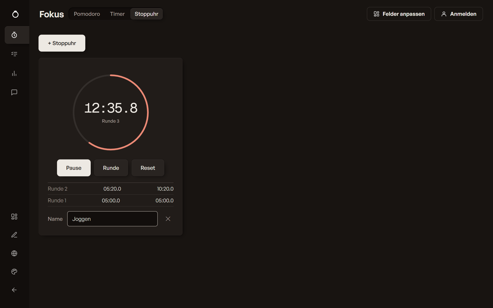 | 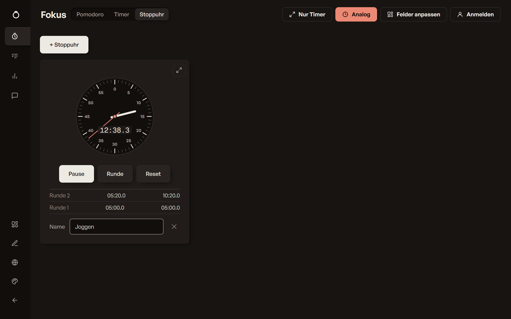 |
  | **Stoppuhr maximiert** | **Pomodoro analog** |
  | 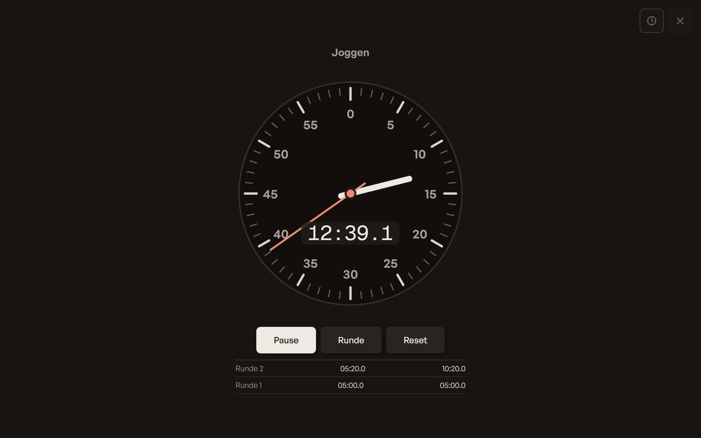 | 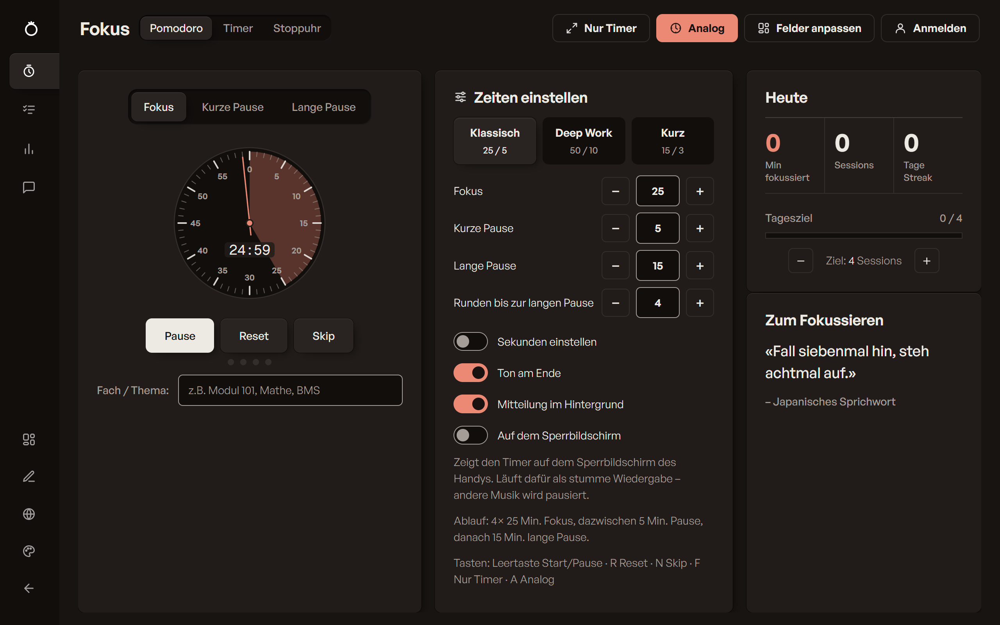 |
  | **Pomodoro maximiert, analog** | **Timer analog (Design Original)** |
  | 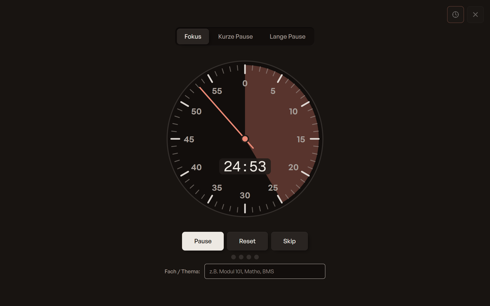 | 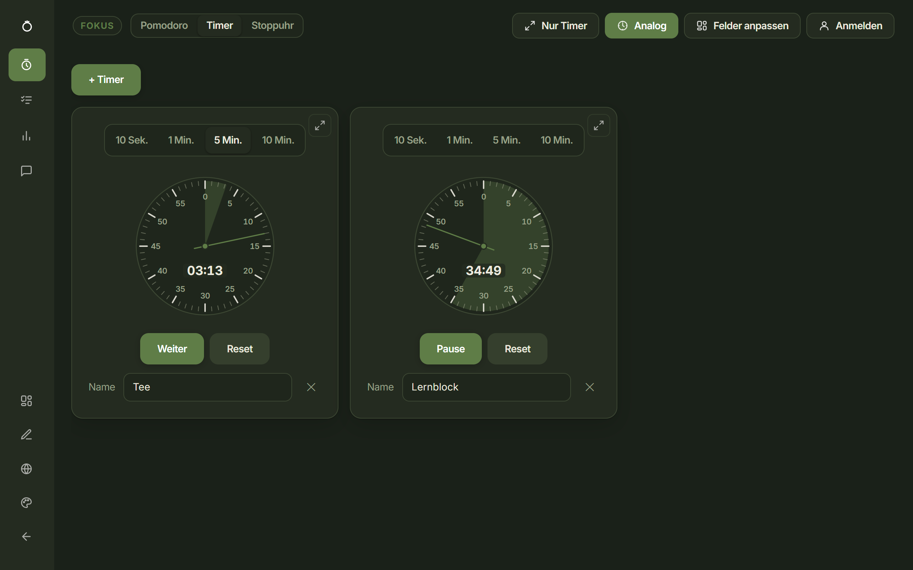 |
  | **Timer maximiert auf dem Handy** | |
  | 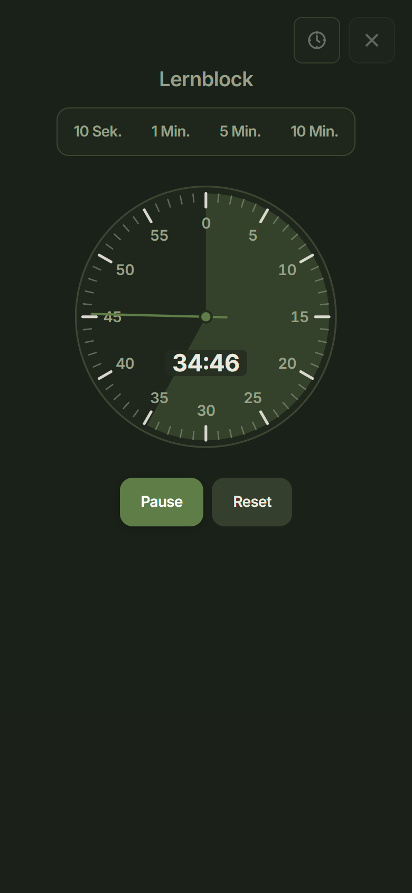 | |

- Doku-Commit: Funktionsliste, Chronik mit Screenshots und Zahlen
  nachgeführt. Nach dem Test durch Namir in `main` übernommen (Fast-Forward)
  und gepusht nach `origin/main`.

### Phase 20 – Passwort und E-Mail ändern (11. November 2026)

| Zeit | Hash | Commit | Branch | Umfang |
| --- | --- | --- | --- | --- |
| 12:19 | `8d1f221` | Passwort und E-Mail im Konto aenderbar | claude/password-email-change-ccd51b | 11, +188 / −7 |
| 12:25 | (dieser Commit) | Dokumentation nachgefuehrt: Passwort und E-Mail aendern | claude/password-email-change-ccd51b | Doku |

- **`8d1f221`** – Wunsch: Man soll sein Passwort und seine E-Mail-Adresse ändern können.
  - Im Konto-Fenster (angemeldet) gibt es zwei Links „E-Mail ändern“ und
    „Passwort ändern“. Sie klappen je ein kleines Formular auf (immer nur eines).
  - **Passwort:** aktuelles Passwort, neues Passwort, Wiederholung. Stimmen die
    beiden neuen nicht überein oder ist das neue gleich dem alten, kommt eine
    Meldung, ohne den Server zu fragen.
  - **E-Mail:** neue Adresse und aktuelles Passwort. Supabase schickt einen
    Bestätigungslink an die neue Adresse (je nach Einstellung „Secure email
    change“ auch an die alte); erst danach gilt sie. Bis dahin bleibt man mit
    der alten angemeldet.
  - Beide Änderungen prüfen zuerst das aktuelle Passwort
    (`verifyPassword()` in `js/cloud.js`, per `signInWithPassword`), damit
    niemand an einem offenen Gerät das Konto übernehmen kann. Danach
    `client.auth.updateUser()`. Neue Fehlermeldungen (falsches Passwort,
    gleiches Passwort, gleiche Adresse, Neu-Anmeldung nötig) in allen 5 Sprachen.
  - CSS in beiden Design-Stylesheets gleich. `CACHE_NAME` auf `fokus-cache-v46`.
  - Geprüft: `npm test` ok; im Browser Auf- und Zuklappen und die Meldung bei
    ungleichen Passwörtern. Die eigentliche Änderung gegen Supabase ist noch
    nicht mit einem echten Konto durchgespielt.

  | Vorher (angemeldet) | Nachher: E-Mail ändern |
  | --- | --- |
  | 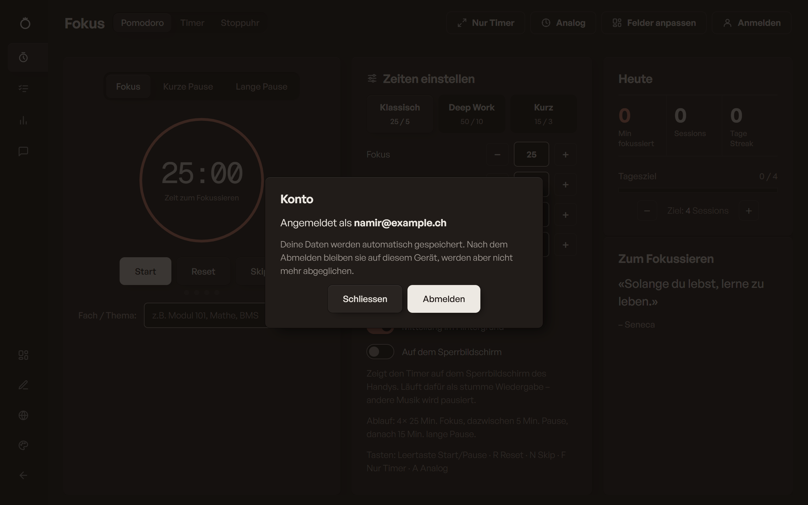 | 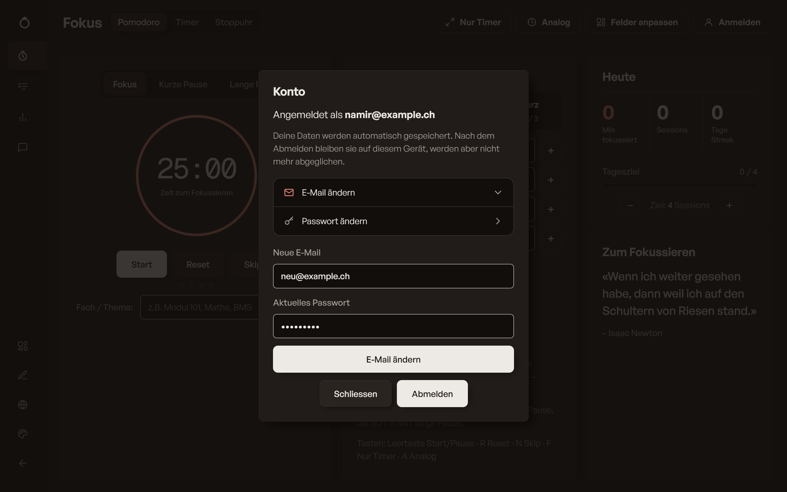 |
  | **Passwort ändern** | **Nach dem Absenden (Design Original)** |
  | 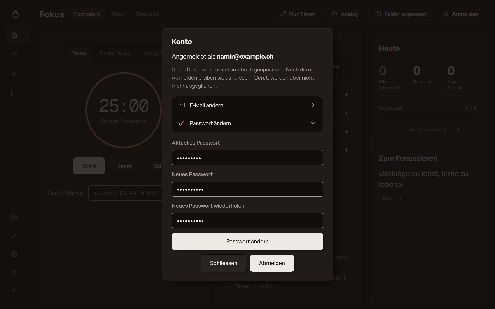 | 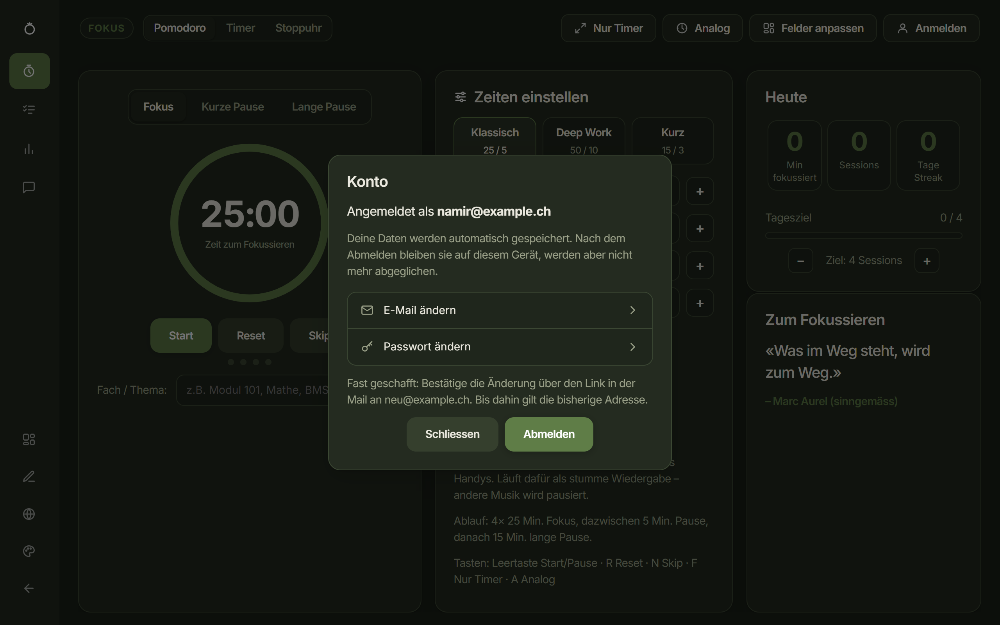 |
  | **Passwort ändern auf dem Handy** | |
  | 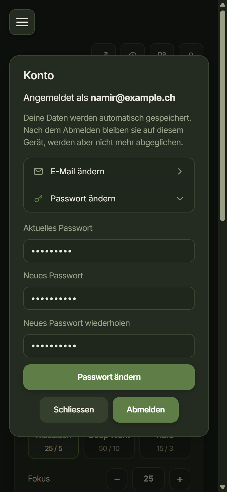 | |

- Doku-Commit: Funktionsliste, Chronik mit Screenshots und Zahlen nachgeführt.

---

## 4. Zahlen

| | |
| --- | --- |
| Zeitraum | 6. Oktober – 11. November 2026 |
| Commits | 115 (davon 2 Merges) |
| Aktive Tage | 15 (6., 7., 8., 9., 21., 22. Okt., 1., 2., 3., 4., 5., 6., 8., 9., 11. Nov.) |
| Meiste Commits an einem Tag | 7. Oktober (17) |
| Grösster Commit | `26003a3` Windows- und iOS-App (+5713 Zeilen) |

## 5. Offene Punkte / Hinweise

- Nach Änderungen an Web-Dateien `CACHE_NAME` in `sw.js` hochzählen, sonst
  sehen Browser-Nutzer die alte Version.
- Für die Apps nach Änderungen `npm run build` (Windows) bzw. `npm run ios:sync` (iOS).
- Live-Sync: `user_data` ist in der Publication `supabase_realtime`
  (am 8. November im SQL Editor geprüft, `pg_publication_tables`). Bei
  gleichzeitigen Aktionen gewinnt die letzte; die Geräteuhren müssen ungefähr
  stimmen. Mit zwei echten Geräten noch nicht durchgetestet.
- Passwort/E-Mail ändern: mit einem echten Konto testen. In Supabase unter
  Authentication → URL Configuration muss die Seiten-URL als Redirect erlaubt
  sein, sonst führt der Bestätigungslink auf die Site URL.
- iOS-App: Live Activity, Mitteilung am Ende und Icon-Wechsel bauen in der Cloud
  fehlerfrei, sind aber noch auf keinem echten iPhone gesehen worden. Beim
  ersten Aufspielen prüfen: Zeile auf Sperrbildschirm und Dynamic Island,
  Pause/Weiter, „Zeit ist um!“ nach Ablauf, Mitteilung mit Ton im Hintergrund.
  Knöpfe gibt es erst ab iOS 17; drückt man sie, übernimmt die App den Stand
  beim nächsten Öffnen (vorher sehen andere Geräte ihn nicht). Startet man
  den Timer auf einem anderen Gerät, erscheint sie erst nach dem Öffnen der App
  (Start aus der Ferne bräuchte Push über APNs: bezahlter Developer-Account
  und Server). Eigene Timer/Stoppuhren erscheinen dort nicht, nur der Pomodoro.
  Da Coral das Standard-Design ist, wechselt das App-Icon beim ersten Start
  einmal (mit iOS-Hinweis).
- Sperrbildschirm: Auf einem echten iPhone (Web-App vom Homescreen) testen, ob
  Balken, Knöpfe und der Ton am Ende im Hintergrund wie erwartet laufen. Wird
  der Timer auf einem anderen Gerät gestartet, erscheint die Karte erst nach
  einem Tipp in der App (Autoplay-Sperre). Die Karte pausiert Musik anderer
  Apps – wer das nicht will, nimmt die iOS-App (Live Activity, siehe oben).
- Web/PWA: Ist der Browser-Tab bzw. die PWA ganz geschlossen, kann keine
  Mitteilung kommen (läuft kein Code). Dafür bräuchte es Web-Push über einen
  Server (z.B. Supabase Edge Function).
- Die Windows-`.exe` ist nicht signiert (SmartScreen-Warnung beim ersten Start).
- Branches: Am 9. November aufgeräumt (siehe Phase 16). Übrig sind `main`,
  der Arbeitsbranch `claude/app-website-next-steps-…` sowie lokal
  `hallmark-coral`/`hallmark-test` – deren Ordner (`Podomoro-Timer-coral`,
  `Podomoro-Timer-hallmark`) haben ungesicherte `.hallmark/`-Notizen; erst
  sichern, dann mit `git worktree remove` und `git branch -d` entfernen.
- Git-Autorname: über `.mailmap` vereinheitlicht. Für künftige Commits überall
  `git config user.name "Namir Al Gorani"` setzen.
- Screenshots nach grösseren Änderungen neu erzeugen: `npm run screenshots`.
- Design-Änderungen: Grössen (Abstände, Schriftgrössen) immer in **beiden**
  Stylesheets gleich halten, danach `npm run build && npx electron
  tools/compare-designs.js` (und mit `--breite 390`) laufen lassen.
  Auf dem Handy (390 px) weichen ein paar Felder noch um wenige Pixel ab, weil
  dort manche Felder so breit wie ihr Inhalt werden (war in Coral schon so).
