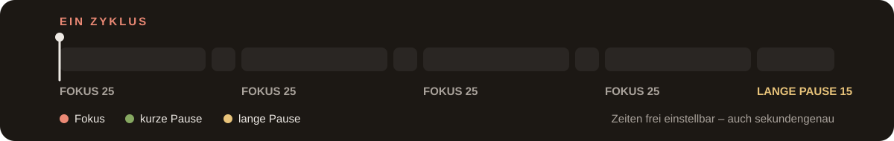
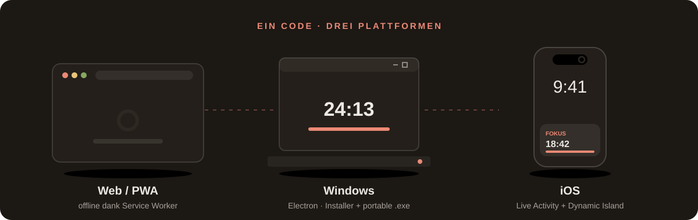
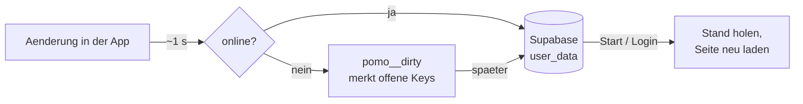
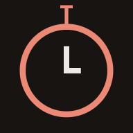

<div align="center">

<a href="https://namir1234.github.io/Podomoro-Timer/">
  
</a>

<br>

<a href="https://namir1234.github.io/Podomoro-Timer/"></a>


<br><br>

**Pomodoro-Timer mit Statistik, To-dos und Zitaten.**<br>
Die Daten liegen auf dem Geraet (`localStorage`). Wer will, meldet sich an und gleicht sie<br>
ueber Supabase zwischen Geraeten ab. Derselbe Code laeuft als **Webseite**, als **Windows-Programm** und als **iOS-App**.

**[Live ausprobieren](https://namir1234.github.io/Podomoro-Timer/)** · im Browser oeffnen oder ueber „Zum Home-Bildschirm“ / „App installieren“ als App einrichten


</div>

<details>
<summary><b>Alle Funktionen als Liste</b></summary>
<br>

- Pomodoro mit Fokus, kurzer und langer Pause; dazu beliebig viele eigene Timer und Stoppuhren
- Tagesziel, Streak, Ueberzeit („mehr gearbeitet“ / „Pause ueberzogen“)
- Statistik pro Tag, Woche und Fach, Verlauf ueber 7 Tage, 12 Wochen oder 12 Monate, Export als CSV
- To-dos mit Faelligkeitsdatum; ▶ startet den Timer mit dem To-do als Fach und zeigt die investierte Zeit
- Felder frei verschieben und in der Groesse aendern, Nur-Timer-Ansicht
- Tastenkuerzel: <kbd>Leertaste</kbd> Start/Pause, <kbd>R</kbd> Reset, <kbd>N</kbd> Skip, <kbd>F</kbd> Nur Timer
- Live-Sync zwischen Geraeten, Timer auf dem Sperrbildschirm (Handy)
- Deutsch, Englisch, Franzoesisch, Italienisch, Ungarisch; zwei Designs (Coral, Original)

</details>

<div align="center">
















| Timer | To-dos | Handy |
| :---: | :---: | :---: |
|  |  |  |

<sub>Die Screenshots erzeugt <code>npm run screenshots</code> mit Beispieldaten (eigenes, leeres Profil – echte Daten bleiben unberuehrt).</sub>






</div>

## Aufbau

| Ordner | Inhalt |
| --- | --- |
| `pages/`, `js/`, `style/`, `img/` | die eigentliche App – hier wird entwickelt |
| `tools/` | Build-Script, Icon-Renderer und der Smoke-Test |
| `electron/` | Fenster-Huelle fuer Windows |
| `ios/` | Xcode-Projekt (von Capacitor erzeugt) |
| `dist/` | aus den Quellen erzeugt, nicht von Hand bearbeiten |
| `release/` | fertige Windows-Dateien |

`npm run build` kopiert die Web-Dateien nach `dist/` und nimmt dabei die
Service-Worker-Registrierung heraus (die ist nur im Browser sinnvoll) und
setzt eine Content-Security-Policy. Beide App-Varianten laden aus `dist/`.

> [!TIP]
> Die animierten Grafiken in diesem README liegen in `img/readme/` – reine SVGs mit CSS-Animationen,
> die auch `prefers-reduced-motion` respektieren.

## Web

Die Dateien im Projektordner sind direkt die Webseite – `pages/index.html`
oeffnen oder den Ordner auf einen Webserver legen. `sw.js` macht sie
offlinefaehig.

> [!IMPORTANT]
> Nach Aenderungen an den Assets die `CACHE_NAME`-Version in `sw.js` hochzaehlen,
> sonst bekommen Nutzer die alte Fassung.


## Login und Cloud-Sync

<details>
<summary><b>Einrichten und Abgleich</b> – aufklappen</summary>

Login und Speicherung pro Konto laufen ueber [Supabase](https://supabase.com)
(Gratis-Tarif reicht). Solange `js/cloud-config.js` leer ist, ist die
Funktion aus und der Knopf „Anmelden“ erscheint gar nicht.

**Einrichten:**

1. Auf supabase.com ein Konto und ein neues Projekt anlegen (Free Plan).
2. Im Dashboard unter „SQL Editor“ den Inhalt von `supabase/schema.sql`
   ausfuehren. Das legt die Tabelle `user_data` mit Row-Level-Security an,
   damit jede Person nur ihre eigenen Daten sieht.
3. Unter „Authentication“ → „Sign In / Providers“ ist „Email“ schon aktiv.
   Empfehlung: dort „Confirm email“ ausschalten. Der Gratis-Tarif verschickt
   nur wenige Mails pro Stunde, und ohne Bestaetigung ist man nach dem
   Registrieren direkt angemeldet.
4. Unter „Project Settings“ → „API“ die „Project URL“ und den
   „anon public“-Key kopieren und in `js/cloud-config.js` eintragen.
   Der anon-Key darf oeffentlich sein, die Daten schuetzt die Row-Level-Security.
5. `CACHE_NAME` in `sw.js` hochzaehlen und fuer die Apps `npm run build`
   ausfuehren. Das Build-Script erlaubt die Supabase-URL in der
   Content-Security-Policy.



**So funktioniert der Abgleich:** Jeder `pomo_*`-Key ist eine Zeile in
`user_data`, ausser `pomo_menu`, das pro Geraet bleibt (Feldgroessen und Design werden mitsynchronisiert). Aenderungen werden nach etwa einer Sekunde hochgeladen; offline
merkt sich die App die offenen Keys (`pomo__dirty`) und holt das spaeter nach.
Beim Start und beim Login holt sie den Stand aus der Cloud und laedt die
Seite neu, falls sich etwas geaendert hat. Die Statistik (`pomo_sessions`)
wird bei jedem Abgleich zusammengefuehrt, sonst gilt der zuletzt gespeicherte
Stand.
Nach dem Abmelden bleiben die Daten auf dem Geraet, werden aber nicht mehr
abgeglichen.

</details>

## Windows

<details>
<summary><b>Befehle und Hinweise</b> – aufklappen</summary>

```
npm start        # App starten
npm test         # prueft, dass die Oberflaeche wirklich rendert
npm run dist:win # Installer und portable .exe nach release/
```

`release/Fokus Setup 1.1.0.exe` installiert die App, `release/Fokus 1.1.0.exe`
laeuft ohne Installation.

Die Seiten werden ueber ein eigenes `app://`-Protokoll ausgeliefert, nicht
ueber `file://`. Das gibt der App einen festen Origin, damit der
`localStorage` ueber Updates hinweg erhalten bleibt.

> [!WARNING]
> Die `.exe` ist nicht signiert. Windows SmartScreen zeigt darum beim ersten
> Start eine Warnung; ueber „Weitere Informationen“ → „Trotzdem ausfuehren“
> laesst sie sich starten.

</details>

## iOS

<details>
<summary><b>Live Activity, Cloud-Build und Xcode</b> – aufklappen</summary>

Das Xcode-Projekt liegt in `ios/`. Es hat zwei Targets: `App` (die Web-App in
Capacitor, plus `FokusTimerPlugin.swift`) und `FokusWidget` (Live Activity).

### Live Activity

In der iOS-App steht der laufende Pomodoro als eigene Zeile auf dem
Sperrbildschirm und in der Dynamic Island – wie der Timer der Uhr-App, und
Musik aus Spotify & Co. laeuft weiter. Countdown und Balken zaehlt iOS selbst,
die App muss dafuer nicht offen sein. Am Ende kommt eine Mitteilung mit Ton.
Aufgebaut wie der Timer der Uhr-App: Pause/Weiter- und Stopp-Knopf (ab
iOS 17), Beschriftung und grosse Zeit; in der Dynamic Island ein Ring, der
sich leert. Ein-/ausschalten: „Auf dem Sperrbildschirm“ in den
Zeiteinstellungen. Braucht iOS 16.2 oder neuer.

- `ios/App/Shared/FokusTimerAttributes.swift` – Daten der Anzeige (beide Targets)
- `ios/App/Shared/FokusTimerIntents.swift` – Knoepfe (Pause/Weiter, Stopp); die App
  holt die Aktion beim naechsten Oeffnen ab (`takePending`)
- `ios/App/FokusWidget/FokusWidget.swift` – Aussehen (Sperrbildschirm, Dynamic Island)
- `ios/App/App/FokusTimerPlugin.swift` – `update`/`end` der Live Activity,
  `schedule` der Mitteilung; aufgerufen aus `js/pomodoro.js` (`drawLive`,
  `syncNativeNotify`)

### Ohne Mac: Cloud-Build und Sideloadly

Bei jedem Push auf `main` (der App-Dateien betrifft) baut GitHub Actions die
App auf einem Mac (`.github/workflows/ios.yml`). Von Hand: Actions →
„iOS-App bauen“ → „Run workflow“.

1. GitHub → Actions → letzter gruener Lauf „iOS-App bauen“ → unten bei
   „Artifacts“ **Fokus-iOS** herunterladen und entpacken → `Fokus.ipa`.
2. Auf dem PC [Sideloadly](https://sideloadly.io) installieren, dazu iTunes und
   iCloud **von apple.com** (nicht aus dem Microsoft Store).
3. iPhone per Kabel anschliessen, „Diesem Computer vertrauen“.
4. In Sideloadly `Fokus.ipa` hineinziehen, Apple-ID eintragen, Start.
5. Auf dem iPhone: Einstellungen → Allgemein → VPN und Geraeteverwaltung →
   die eigene Apple-ID → „Vertrauen“. Ab iOS 16 zusaetzlich
   Einstellungen → Datenschutz & Sicherheit → Entwicklermodus einschalten.

> [!NOTE]
> Mit einer Gratis-Apple-ID laeuft die App 7 Tage, dann mit Sideloadly erneut
> aufspielen (die Daten bleiben).

### Mit Mac

Zum Bauen in Xcode braucht es einen Mac mit Xcode und CocoaPods.

Auf dem Mac:

```
npm install
npm run ios:sync   # baut dist/ und kopiert es ins Xcode-Projekt
npm run ios:open   # oeffnet Xcode
```

In Xcode unter „Signing & Capabilities“ das eigene Entwickler-Team
auswaehlen, dann auf das Geraet bauen. Ohne bezahlten Developer-Account
laeuft die App sieben Tage, danach muss sie neu aufgespielt werden.

Nach jeder Aenderung am Web-Code `npm run ios:sync` ausfuehren.

</details>

## App-Icon

<details>
<summary><b>Icons pro Design</b> – aufklappen</summary>

Es gibt ein Icon pro Design: `img/icons/icon-source.svg` (Original, gruen) und
`img/icons/icon-coral-source.svg` (Coral). `npm run icons` rendert daraus die
1024er Icons fuer iOS (`AppIcon` und `AppIconCoral`) sowie die Coral-PNGs in
`img/icons/`. Die Original-PNGs dort (`icon-192.png`, `icon-512.png`,
`apple-touch-icon.png`) bleiben davon unberuehrt.

<p>
  &nbsp;
  
</p>

Wechselt man das Design, wechselt das Icon mit (`js/design-boot.js`):

- **Browser:** Tab-Icon und Icon fuer „Zum Home-Bildschirm“.
- **Windows:** Fenster- und Taskleisten-Icon (ueber `electron/preload.js`).
  Die `.exe` und die Verknuepfung behalten das Original-Icon, das laesst
  Windows nicht zur Laufzeit aendern.
- **iOS:** Homescreen-Icon als alternatives App-Icon (Plugin `FokusIcon` in
  `AppDelegate.swift`). iOS zeigt dabei jedes Mal kurz den Hinweis, dass das
  Icon geaendert wurde.

</details>

<br>

<div align="center">
  
</div>
