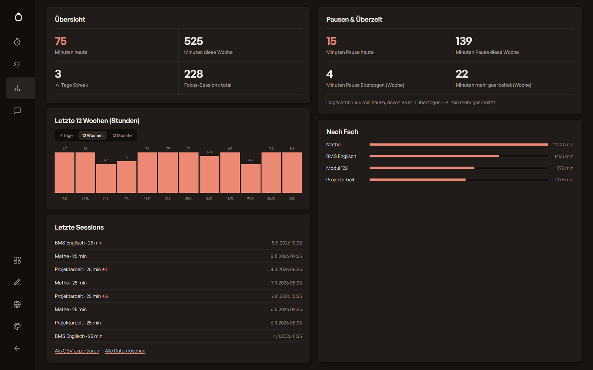
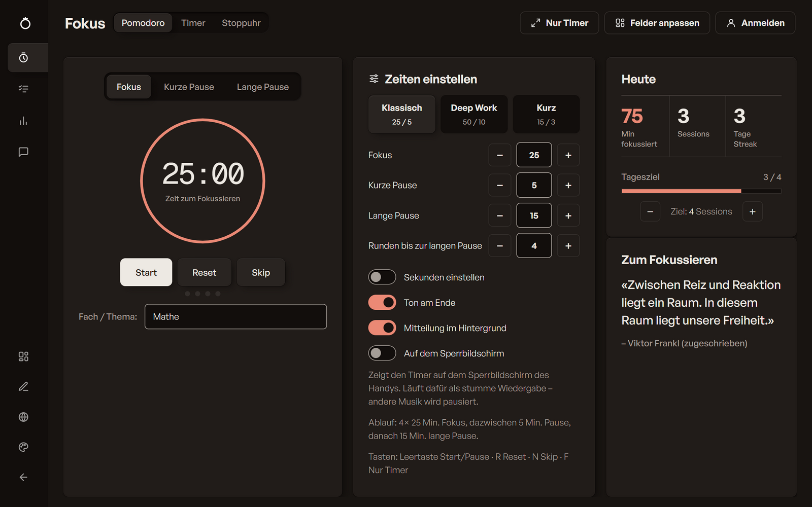
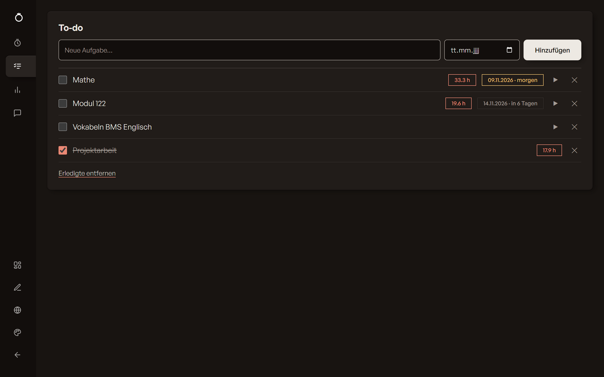
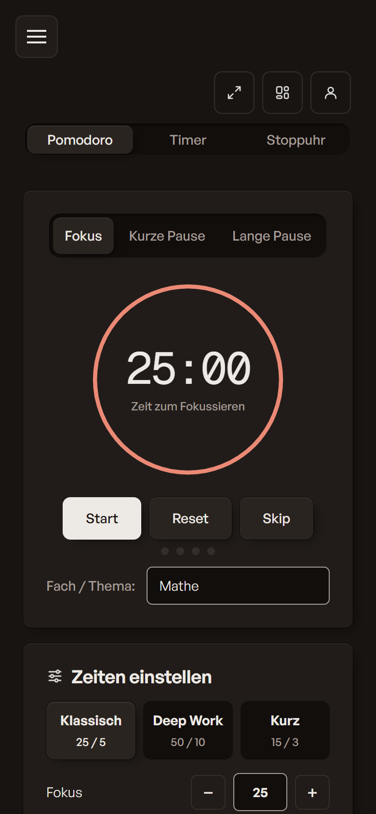

# Fokus – Pomodoro Timer

**Live:** https://namir1234.github.io/Podomoro-Timer/ – im Browser oeffnen
oder ueber "Zum Home-Bildschirm" / "App installieren" als App einrichten.

Pomodoro-Timer mit Statistik, To-dos und Zitaten.
Die Daten liegen auf dem Geraet (`localStorage`). Wer will, meldet sich an
und gleicht sie ueber Supabase zwischen Geraeten ab (siehe "Login und Cloud-Sync").

Derselbe Code laeuft als Webseite, als Windows-Programm und als iOS-App.



| Timer | To-dos | Handy |
| --- | --- | --- |
|  |  |  |

## Was die App kann

- Pomodoro mit Fokus, kurzer und langer Pause; dazu beliebig viele eigene Timer und Stoppuhren
- Tagesziel, Streak, Ueberzeit ("mehr gearbeitet" / "Pause ueberzogen")
- Statistik pro Tag, Woche und Fach, Verlauf ueber 7 Tage, 12 Wochen oder 12 Monate, Export als CSV
- To-dos mit Faelligkeitsdatum; ▶ startet den Timer mit dem To-do als Fach und zeigt die investierte Zeit
- Felder frei verschieben und in der Groesse aendern, Nur-Timer-Ansicht
- Tastenkuerzel: Leertaste Start/Pause, R Reset, N Skip, F Nur Timer
- Live-Sync zwischen Geraeten, Timer auf dem Sperrbildschirm (Handy)
- Deutsch, Englisch, Franzoesisch, Italienisch, Ungarisch; zwei Designs (Coral, Original)

Die Screenshots erzeugt `npm run screenshots` mit Beispieldaten (eigenes,
leeres Profil – echte Daten bleiben unberuehrt).

## Aufbau

| Ordner | Inhalt |
| --- | --- |
| `pages/`, `js/`, `style/`, `img/` | die eigentliche App – hier wird entwickelt |
| `tools/` | Build-Script, Icon-Renderer und der Smoke-Test |
| `electron/` | Fenster-Huelle fuer Windows |
| `ios/` | Xcode-Projekt (von Capacitor erzeugt) |
| `dist/` | aus den Quellen erzeugt, nicht von Hand bearbeiten |
| `release/` | fertige Windows-Dateien |

`npm run build` kopiert die Web-Dateien nach `dist/` und nimmt dabei die
Service-Worker-Registrierung heraus (die ist nur im Browser sinnvoll) und
setzt eine Content-Security-Policy. Beide App-Varianten laden aus `dist/`.

## Web

Die Dateien im Projektordner sind direkt die Webseite – `pages/index.html`
oeffnen oder den Ordner auf einen Webserver legen. `sw.js` macht sie
offlinefaehig; nach Aenderungen an den Assets die `CACHE_NAME`-Version in
`sw.js` hochzaehlen, sonst bekommen Nutzer die alte Fassung.

## Login und Cloud-Sync

Login und Speicherung pro Konto laufen ueber [Supabase](https://supabase.com)
(Gratis-Tarif reicht). Solange `js/cloud-config.js` leer ist, ist die
Funktion aus und der Knopf "Anmelden" erscheint gar nicht.

Einrichten:

1. Auf supabase.com ein Konto und ein neues Projekt anlegen (Free Plan).
2. Im Dashboard unter "SQL Editor" den Inhalt von `supabase/schema.sql`
   ausfuehren. Das legt die Tabelle `user_data` mit Row-Level-Security an,
   damit jede Person nur ihre eigenen Daten sieht.
3. Unter "Authentication" → "Sign In / Providers" ist "Email" schon aktiv.
   Empfehlung: dort "Confirm email" ausschalten. Der Gratis-Tarif verschickt
   nur wenige Mails pro Stunde, und ohne Bestaetigung ist man nach dem
   Registrieren direkt angemeldet.
4. Unter "Project Settings" → "API" die "Project URL" und den
   "anon public"-Key kopieren und in `js/cloud-config.js` eintragen.
   Der anon-Key darf oeffentlich sein, die Daten schuetzt die Row-Level-Security.
5. `CACHE_NAME` in `sw.js` hochzaehlen und fuer die Apps `npm run build`
   ausfuehren. Das Build-Script erlaubt die Supabase-URL in der
   Content-Security-Policy.

So funktioniert der Abgleich: Jeder `pomo_*`-Key ist eine Zeile in
`user_data`, ausser `pomo_menu`, das pro Geraet bleibt (Feldgroessen und Design werden mitsynchronisiert). Aenderungen werden nach etwa einer Sekunde hochgeladen; offline
merkt sich die App die offenen Keys (`pomo__dirty`) und holt das spaeter nach.
Beim Start und beim Login holt sie den Stand aus der Cloud und laedt die
Seite neu, falls sich etwas geaendert hat. Die Statistik (`pomo_sessions`)
wird bei jedem Abgleich zusammengefuehrt, sonst gilt der zuletzt gespeicherte
Stand.
Nach dem Abmelden bleiben die Daten auf dem Geraet, werden aber nicht mehr
abgeglichen.

## Windows

```
npm start        # App starten
npm test         # prueft, dass die Oberflaeche wirklich rendert
npm run dist:win # Installer und portable .exe nach release/
```

`release/Fokus Setup 1.1.0.exe` installiert die App, `release/Fokus 1.1.0.exe`
laeuft ohne Installation.

Die Seiten werden ueber ein eigenes `app://`-Protokoll ausgeliefert, nicht
ueber `file://`. Das gibt der App einen festen Origin, damit der
`localStorage` ueber Updates hinweg erhalten bleibt.

Die `.exe` ist nicht signiert. Windows SmartScreen zeigt darum beim ersten
Start eine Warnung; ueber "Weitere Informationen" → "Trotzdem ausfuehren"
laesst sie sich starten.

## iOS

Das Xcode-Projekt liegt in `ios/`. Zum Bauen braucht es einen Mac mit Xcode
und CocoaPods – von Windows aus geht nur die Vorbereitung.

Auf dem Mac:

```
npm install
npm run ios:sync   # baut dist/ und kopiert es ins Xcode-Projekt
npm run ios:open   # oeffnet Xcode
```

In Xcode unter "Signing & Capabilities" das eigene Entwickler-Team
auswaehlen, dann auf das Geraet bauen. Ohne bezahlten Developer-Account
laeuft die App sieben Tage, danach muss sie neu aufgespielt werden.

Nach jeder Aenderung am Web-Code `npm run ios:sync` ausfuehren.

## App-Icon

Es gibt ein Icon pro Design: `img/icons/icon-source.svg` (Original, gruen) und
`img/icons/icon-coral-source.svg` (Coral). `npm run icons` rendert daraus die
1024er Icons fuer iOS (`AppIcon` und `AppIconCoral`) sowie die Coral-PNGs in
`img/icons/`. Die Original-PNGs dort (`icon-192.png`, `icon-512.png`,
`apple-touch-icon.png`) bleiben davon unberuehrt.

Wechselt man das Design, wechselt das Icon mit (`js/design-boot.js`):

- **Browser:** Tab-Icon und Icon fuer „Zum Home-Bildschirm“.
- **Windows:** Fenster- und Taskleisten-Icon (ueber `electron/preload.js`).
  Die `.exe` und die Verknuepfung behalten das Original-Icon, das laesst
  Windows nicht zur Laufzeit aendern.
- **iOS:** Homescreen-Icon als alternatives App-Icon (Plugin `FokusIcon` in
  `AppDelegate.swift`). iOS zeigt dabei jedes Mal kurz den Hinweis, dass das
  Icon geaendert wurde.
