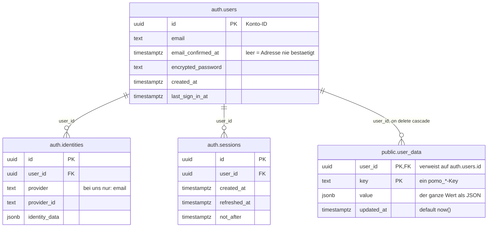
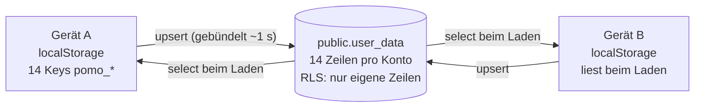

# Datenmodell

Diagramm zu [`schema.sql`](schema.sql). Die App hat genau **eine** eigene Tabelle:
`public.user_data`. Alles rund um Konten und Anmeldung gehört Supabase Auth und wird
nicht von uns angelegt.

Der Schema-Visualizer im Supabase-Dashboard zeichnet immer nur ein Schema. Die
Beziehung `user_data.user_id → auth.users.id` läuft über die Schema-Grenze und ist
dort deshalb nirgends sichtbar — der Grund, warum dieses Diagramm hier steht.

## Tabellen und Beziehungen



`user_data` hat den zusammengesetzten Primärschlüssel `(user_id, key)` — pro Konto also
eine Zeile je Key, aktuell 14 Stück. Löscht man im Dashboard ein Konto, nimmt
`on delete cascade` dessen Zeilen mit.

Vom Schema `auth` sind hier nur die drei Tabellen abgebildet, die die App wirklich
berührt. Supabase legt rund ein Dutzend weitere an (`refresh_tokens`, `mfa_factors`,
`sso_providers`, `flow_state`, `audit_log_entries` …), und `auth.users` hat über
dreissig Spalten statt der sechs hier. Mehrfaktor-Authentifizierung und SSO benutzen
wir nicht.

## Wie Daten in die Zeilen kommen

Der `localStorage` bleibt der Arbeitsspeicher der App und dient offline als Cache. Ist
jemand angemeldet, geht jede Änderung zusätzlich gebündelt nach rund einer Sekunde als
`upsert` in die Tabelle (siehe [`../js/cloud.js`](../js/cloud.js)).



Zwei Sonderfälle, die das Diagramm nicht hergibt:

- `pomo_sessions` wird beim Hochladen über `ts` **vereinigt**, nicht überschrieben, damit
  die Lernstatistik eines anderen Geräts nie verloren geht. Eine leere Liste gilt
  trotzdem — sie kommt nur vom Zurücksetzen der Statistik.
- Die App liest ihre Daten nur beim Laden. Bringt der Abgleich einen neueren Stand, lädt
  die Seite neu.

## Was in `key` steht

Synchronisiert wird, was mit `pomo_` beginnt, nicht mit `pomo__`, und nicht in
`DEVICE_ONLY` steht.

| Key | Inhalt |
| --- | --- |
| `pomo_settings` | Einstellungen |
| `pomo_sessions` | Statistik |
| `pomo_todos` | To-dos |
| `pomo_notebooks` | Notizbücher |
| `pomo_projects` | Projekte |
| `pomo_clocks` | Uhren |
| `pomo_favs` | Favoriten |
| `pomo_custom_quotes` | eigene Zitate |
| `pomo_design` | Design |
| `pomo_layout` | Feldanordnung |
| `pomo_lang` | Sprache |
| `pomo_subject` | Fach |
| `pomo_current_nb` | offenes Notizbuch |
| `pomo_current_project` | offenes Projekt |

Nicht synchronisiert:

- `pomo_menu` — hängt von der Bildschirmgrösse ab und bleibt darum pro Gerät (`DEVICE_ONLY`).
- `pomo__dirty` — merkt sich offene Uploads und ist durch den doppelten Unterstrich
  vom Abgleich ausgenommen.

## Die Policy

Das ist der ganze Schutz. Ohne sie könnte jede angemeldete Person mit dem öffentlichen
anon-Key die Zeilen aller anderen lesen.

```sql
create policy "own rows" on user_data
  for all
  using (auth.uid() = user_id)
  with check (auth.uid() = user_id);
```

`using` entscheidet, welche Zeilen jemand sehen und ändern darf. `with check` verhindert,
dass jemand eine Zeile mit fremder `user_id` einfügt. Fehlt die zweite Hälfte, kann man
in andere Konten schreiben.

## Konten auswerten

Im SQL-Editor des Dashboards. Über den anon-Key geht das nicht — `auth.users` ist von
der App aus nicht abfragbar, und das soll so bleiben.

```sql
select u.email,
       u.created_at,
       u.email_confirmed_at,
       u.last_sign_in_at,
       jsonb_array_length(coalesce(d.value, '[]'::jsonb)) as sessions
from auth.users u
left join user_data d
       on d.user_id = u.id and d.key = 'pomo_sessions'
order by u.created_at desc;
```

Ist `email_confirmed_at` leer, hat die Person ihre Adresse nie bestätigt. Solange unter
*Authentication → Sign In / Providers → Confirm email* die Bestätigung eingeschaltet ist,
kommt dann auch keine Anmeldung zustande.
